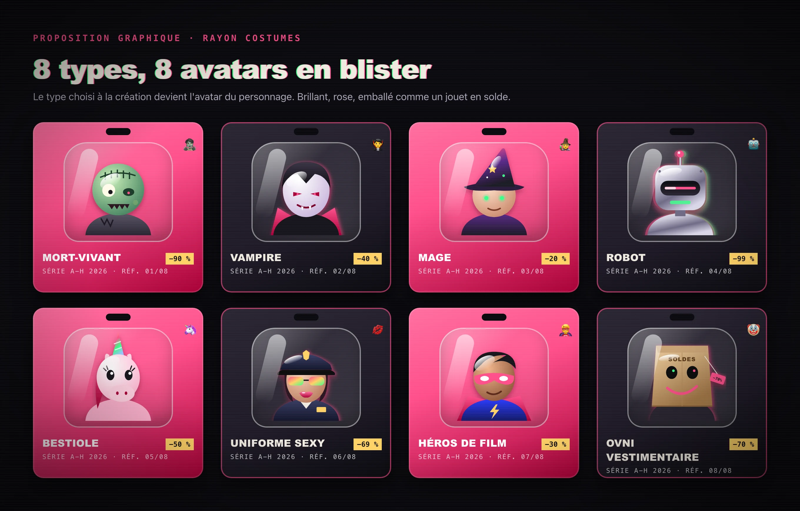
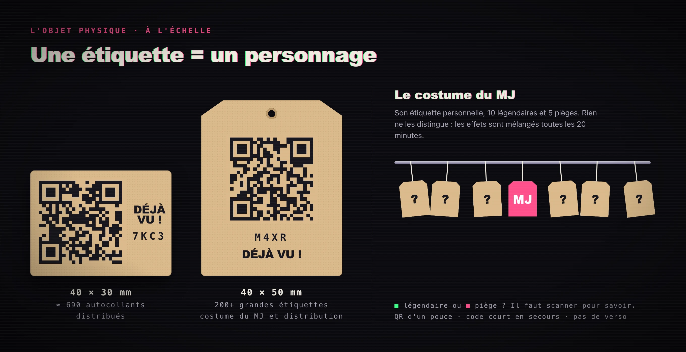
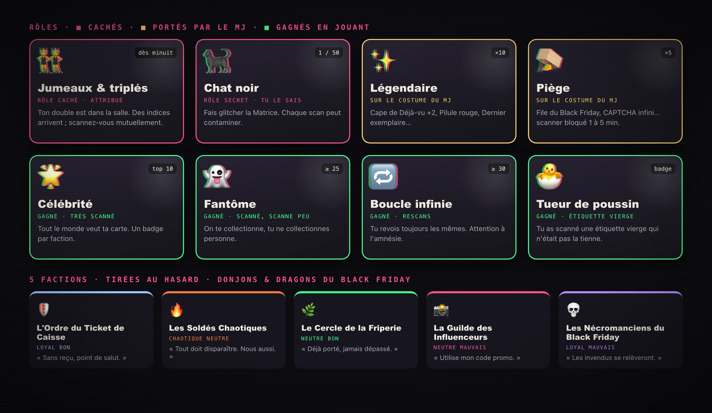
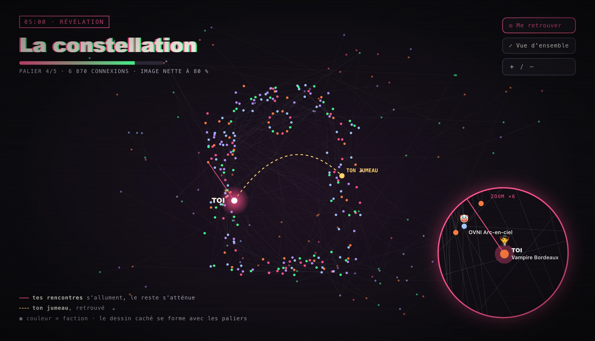

# Pandémonium 2026 — « Déjà vu ! »

  

<b>Tu as déjà vécu cette soirée.</b> Tu ne t'en souviens pas, c'est normal.

## Le concept en 30 secondes

Pour la fête costumée **Pandémonium** (thème : *Déjà vu*), le maître du jeu porte un costume couvert de **fausses étiquettes de vêtements à QR code**, et en distribue à la volée, souvent à des groupes de 4 ou 5. Samedi 7 novembre 2026, Montréal, de 21 h à 5 h.

1. 🏷️ **Reçois une étiquette.** Scanne-la : elle devient **ton personnage**, en 4 écrans, sans compte ni clavier.
2. 📱 **Scanne les autres.** Chaque personne rejoint **ta collection**, avec un **faux souvenir commun** complètement absurde.
3. 🔁 **Revois-les.** Scanner deux fois la même personne, c'est un **déjà vu**. Et ça rapporte.
4. 👯 **Retrouve ton jumeau.** À partir de minuit, la Matrice te donne un double caché dans la salle, et des indices.
5. 🕔 **Révélation à 5 h.** La constellation de toutes les rencontres apparaît sur chaque téléphone, avec ton temps d'écran.

  

## Ton costume, ton avatar

À la création, tu choisis le **type** de ton costume parmi 8, puis sa couleur et ce qu'on voit de loin (masque, cornes, ailes, LED…). Le pseudo, la faction et la classe D&D sont tirés au hasard. Le type devient ton avatar.

  

## Une étiquette, un personnage

Chaque étiquette est **unique** et reste **vierge** jusqu'à son premier scan. Elle ne porte qu'un QR code d'un pouce, un logo et un code court de secours. Sur le costume du MJ, 10 **légendaires** et 5 **pièges** se ressemblent tous : leurs effets sont mélangés toutes les 20 minutes.

  

## Dans ton téléphone

Pas d'app à télécharger : une **page web** s'ouvre au scan, et s'installe sur l'écran d'accueil pour recevoir les **notifications** (jumeau, indices, annonces). L'accueil tient en un gros bouton **Scanner** et une seule suggestion : « Et maintenant ? ».

  

## Des rôles secrets et cinq factions

Comme au **Loup-garou**, personne ne sait qui est qui. Des **jumeaux** à retrouver dans la foule, des **chats noirs** qui font glitcher la Matrice de scan en scan, des rôles qui se gagnent selon ta façon de jouer. Et cinq **factions** tirées de *Donjons & Dragons*, version Black Friday.

  

## Toute la salle joue ensemble

Chaque scan fait avancer une **quête collective** à 5 paliers. À 5 h, le graphe de toutes les rencontres se réorganise pour former un **dessin caché**, d'autant plus net que la salle a franchi de paliers. Chacun s'y retrouve, voit ses rencontres s'allumer et peut zoomer jusqu'aux pseudos.

  

## Le MJ aux commandes

Depuis son téléphone, le MJ suit une frise d'activité et ajuste le jeu en un toucher : **préréglages** de rythme (le serveur lui en suggère par notification), **pause** « Fermé pour inventaire » qui transforme ses étiquettes en pièges, **missions** personnelles et **sanctions** graduées pour qui vient de le scanner.

## Pourquoi ça marche

- **Ça brise la glace.** Pour jouer, il faut aller parler aux autres, les retrouver, se faire scanner en retour.
- **Ça colle au thème.** Le déjà vu est partout : rescans, faux souvenirs, jumeaux, glitchs de la Matrice.
- **Ça fait rire tout le monde.** Fast fashion, soldes, D&D et Matrix, avec un humour accessible (et un peu coquin).
- **Ça critique ce qu'il imite.** Surconsommation punie, rareté artificielle, temps d'écran révélé à la fin.
- **C'est sans friction.** Pas de compte, pas de clavier, un QR code et c'est parti.

> Les illustrations sont des **propositions graphiques** générées pour ce dépôt, dans l'esprit du [teaser](teaser/README.md) : glitch, rose et vert, caméra de surveillance de magasin. Ce ne sont ni des captures d'une application existante ni des maquettes validées ; la direction graphique sera travaillée dans une phase ultérieure. Sources et régénération : [assets/illustrations](assets/illustrations/README.md).

---

## Documentation de référence

Jeu de collection grandeur nature joué avec des **étiquettes de vêtements à QR code** pendant **Pandémonium**, une fête costumée montréalaise organisée autour d'Halloween. Le thème 2026 est **« Déjà vu »**.

Le costume de Florian est fait de fausses étiquettes de vêtements. Il les porte et en distribue aux autres fêtards. Scanner une étiquette ouvre une application web : on y crée son personnage, puis on « collectionne » les personnes croisées dans la soirée. S'y ajoutent des jumeaux à retrouver, des souvenirs absurdes, des glitchs contagieux et une quête collective.

> **Statut du dépôt : phase de spécification (spec-driven development).**
> Il ne contient pas encore de code. Les spécifications décrivent le comportement attendu. Les choix d'implémentation y figurent seulement à titre de propositions, clairement séparées des besoins validés.

## Ordre de lecture

| # | Document | Rôle |
|---|----------|------|
| 1 | [Vision](specs/vision.md) | Problème, utilisateurs, objectifs, périmètre |
| 2 | [Glossaire](specs/glossaire.md) | Vocabulaire du jeu (personnage, étiquette, déjà vu…) |
| 3 | [Univers et ton](specs/univers-et-ton.md) | Thème, humour, références (mode, D&D, Matrix) |
| 4 | [Parcours](specs/parcours.md) | Parcours utilisateur et interactions entre fonctionnalités |
| 5 | [Fonctionnalités](specs/fonctionnalites/README.md) | Une spécification par fonctionnalité (`FEAT-xxx`) |
| 6 | [Données](specs/donnees.md) | Entités, relations, validations, cycle de vie |
| 7 | [Interface](specs/interface.md) | Écrans, navigation, comportements, références visuelles |
| 8 | [Exigences transversales](specs/exigences-transversales.md) | Accessibilité, sécurité, confidentialité, performance (`REQ-xxx`) |
| 9 | [Contraintes techniques](specs/contraintes-techniques.md) | Matériel, hébergement, intégrations connues |
| 10 | [Décisions](specs/decisions.md) | Journal des décisions (`DEC-xxx`) |
| 11 | [Questions ouvertes](specs/questions-ouvertes.md) | Arbitrages nécessaires (`Q-xxx`) |
| 12 | [Plan d'implémentation](specs/plan-implementation.md) | Lots progressifs et traçabilité |
| 13 | [Textes du jeu](specs/textes.md) | Libellés, easter eggs, faux souvenirs, pitch et tutoriel (FR/EN) |
| 14 | [Barème](specs/bareme.md) | Valeurs de score et d'équilibrage, réglables dans l'admin |

## Conventions

### Statuts

Chaque élément porte un statut explicite :

| Statut | Signification |
|--------|---------------|
| **Confirmé** | Demandé ou validé explicitement par Florian |
| **Hypothèse** | Interprétation de ses propos, à confirmer |
| **Proposition** | Recommandation de l'assistant de spécification, non validée |
| **À préciser** | Information manquante ou contradictoire. Renvoie vers une question `Q-xxx` |

Une proposition ne devient une exigence qu'après validation, consignée dans [decisions.md](specs/decisions.md).

### Identifiants

| Préfixe | Objet | Défini dans |
|---------|-------|-------------|
| `FEAT-xxx` | Fonctionnalité | `specs/fonctionnalites/` |
| `RG-xxx-n` | Règle métier de la fonctionnalité `xxx` | fichier de la fonctionnalité |
| `CA-xxx-n` | Critère d'acceptation de la fonctionnalité `xxx` | fichier de la fonctionnalité |
| `REQ-xxx` | Exigence transversale | [exigences-transversales.md](specs/exigences-transversales.md) |
| `CT-xxx` | Contrainte technique | [contraintes-techniques.md](specs/contraintes-techniques.md) |
| `DEC-xxx` | Décision | [decisions.md](specs/decisions.md) |
| `Q-xxx` | Question ouverte | [questions-ouvertes.md](specs/questions-ouvertes.md) |
| `LOT-x` | Lot d'implémentation | [plan-implementation.md](specs/plan-implementation.md) |

Les identifiants sont **stables** : une exigence abandonnée passe au statut « Abandonné » et son numéro n'est jamais réutilisé. Chaque règle n'est définie qu'à un seul endroit. Les autres documents y renvoient par lien.

### Sources

| Code | Source |
|------|--------|
| **S1** | Premier message de Florian : description du projet, achats, six idées commentées, notifications, leaderboard |
| **S2** | Réponse de l'assistant : banque d'idées. Tout ce qui en vient reste une proposition tant que S3 ne le valide pas |
| **S3** | Second message de Florian : retours détaillés sur S2 et nouvelles idées (factions, D&D, mode, photos…) |
| **S4** | Fiches produits Amazon.ca des achats, consultées le 2026-11-03 |
| **S5** | Entretien du 2026-11-05 : réponses de Florian aux questions ouvertes Q-001 à Q-034 |
| **S6** | Message de Florian du 2026-11-05, après l'entretien : multi-étiquettes, PIN, données dans le cloud, temps d'écran, costumes, légendaires et pièges, jumeaux à 2 h |
| **S7** | Message et second entretien de Florian du 2026-11-05 : réponses à Q-035 à Q-043, factions, mélange des légendaires, validation carte par carte, surconsommation, admin et frise d'activité |
| **S8** | Message de Florian du 2026-11-05, après la relecture d'ensemble : création en 4 écrans, faction au hasard, emoji = type, notifications et scanner dans le périmètre, grand format 40×50 mm, distribution en groupe |
| **S9** | Message de Florian du 2026-11-05 : barème validé, préréglages et suggestions au MJ, mode pause, sanctions graduées, invités qui se connaissent ; questions sur le graphe D3.js |
| **S10** | Message de Florian du 2026-11-05 : confirmation de classements et badges, missions personnelles confiées par le MJ, validation du pitch, du tutoriel et des textes du MJ |
| **S11** | Message de Florian du 2026-11-05 : révision du README et direction graphique inspirée du teaser (glitch, rose, surveillance de magasin, avatars glossy) |
| **S12** | Message de Florian du 2026-11-05 : validation du format des codes d'étiquette |

## Résumé en une phrase

*Tu scannes quelqu'un, tu l'ajoutes à ta collection, l'app t'invente un souvenir commun absurde. Plus tu revois les mêmes personnes, plus la Matrice glitche.*

## Licence

[Apache 2.0](LICENSE).
