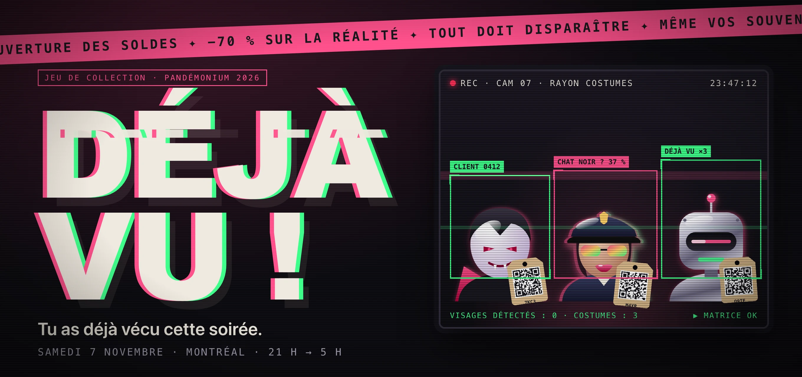
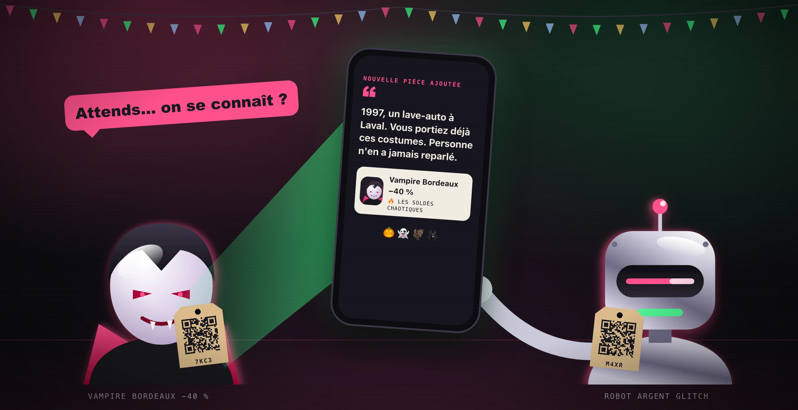
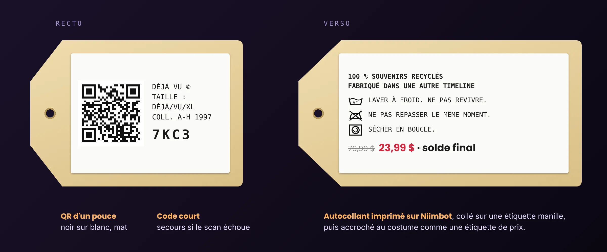
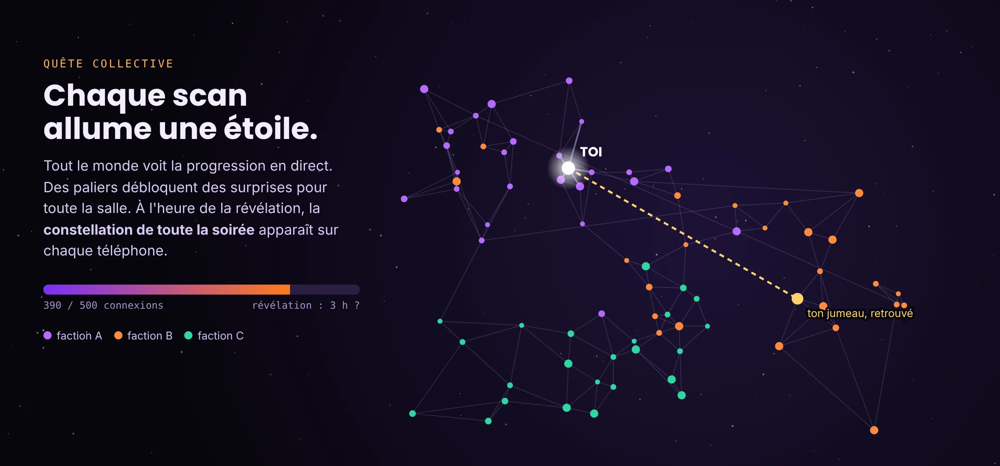

# Pandémonium 2026 — « Déjà vu ! »

  

<b>Tu as déjà vécu cette soirée.</b> Tu ne t'en souviens pas, c'est normal.

## Le concept en 30 secondes

Pour la fête costumée **Pandémonium** (thème : *Déjà vu*), le déguisement est fait de **fausses étiquettes de vêtements**, et chacune porte un **QR code**. Florian en porte et en distribue. Les fêtards les accrochent à leur costume et se scannent entre eux avec leur téléphone.

1. 🏷️ **Reçois une étiquette.** Tu la scannes : elle devient **ton personnage**. Trois touchers, sans clavier.
2. 📱 **Scanne les autres.** Chaque personne scannée rejoint **ta collection**, avec un **faux souvenir commun** complètement absurde.
3. 🔁 **Revois-les.** Scanner deux fois la même personne n'est pas une erreur, c'est un **déjà vu**. Et ça rapporte.

  

## Une étiquette, un personnage

Chaque étiquette est **unique**. Elle reste **vierge** jusqu'au premier scan : la première personne qui la scanne crée le personnage qui va avec. Florian n'a rien à préparer par invité. Le verso parodie les consignes d'entretien d'un vêtement de fast fashion.

  

## Dans ton téléphone

Pas d'app à télécharger depuis un magasin d'applications : une **page web** s'ouvre au scan, et on peut l'installer sur l'écran d'accueil.

  

## Des rôles secrets, comme au Loup-garou

Comme dans le jeu du **Loup-garou**, personne ne sait qui est qui. Certaines étiquettes cachent un rôle : des **jumeaux** à retrouver dans la foule, des **chats noirs** qui font glitcher la Matrice et dont le bug se propage de scan en scan. D'autres rôles se gagnent pendant la soirée, selon ta façon de jouer.

  

## Toute la salle joue ensemble

Chaque scan fait avancer une **quête collective** visible par tous, en direct. Des paliers débloquent des surprises pour toute la salle. À l'heure de la révélation, la **constellation de toutes les rencontres de la soirée** apparaît sur chaque téléphone.

  

## Pourquoi ça marche

- **Ça brise la glace.** Pour jouer, il faut aller parler aux autres, les retrouver, se faire scanner en retour.
- **Ça colle au thème.** Le déjà vu est partout : rescans, faux souvenirs, jumeaux, glitchs de la Matrice.
- **Ça fait rire tout le monde.** Fast fashion, soldes, D&D et Matrix, avec un humour accessible (et un peu coquin).
- **C'est sans friction.** Pas de compte, pas de clavier, un QR code et c'est parti.
- **Ça laisse un souvenir.** Le lendemain, chacun retrouve sa collection et peut partager ses exploits.

> Les illustrations ci-dessus sont des **propositions générées pour ce dépôt**. Ce ne sont pas des photos du costume réel, et les QR codes pointent vers des URL d'exemple. Détails et statut : [assets/illustrations](assets/illustrations/README.md).

---

## Documentation de référence

Jeu de collection grandeur nature joué avec des **étiquettes de vêtements à QR code** pendant **Pandémonium**, une fête costumée montréalaise organisée autour d'Halloween. Le thème 2026 est **« Déjà vu »**.

Le costume de Florian est fait de fausses étiquettes de vêtements. Il les porte et en distribue aux autres fêtards. Scanner une étiquette ouvre une application web : on y crée son personnage, puis on « collectionne » les personnes croisées dans la soirée. S'y ajoutent des jumeaux à retrouver, des souvenirs absurdes, des glitchs contagieux et une quête collective.

> **Statut du dépôt : phase de spécification (spec-driven development).**
> Il ne contient pas encore de code. Les spécifications décrivent le comportement attendu. Les choix d'implémentation y figurent seulement à titre de propositions, clairement séparées des besoins validés.

## Ordre de lecture

| # | Document | Rôle |
|---|----------|------|
| 1 | [Vision](specs/vision.md) | Problème, utilisateurs, objectifs, périmètre |
| 2 | [Glossaire](specs/glossaire.md) | Vocabulaire du jeu (personnage, étiquette, déjà vu…) |
| 3 | [Univers et ton](specs/univers-et-ton.md) | Thème, humour, références (mode, D&D, Matrix) |
| 4 | [Parcours](specs/parcours.md) | Parcours utilisateur et interactions entre fonctionnalités |
| 5 | [Fonctionnalités](specs/fonctionnalites/README.md) | Une spécification par fonctionnalité (`FEAT-xxx`) |
| 6 | [Données](specs/donnees.md) | Entités, relations, validations, cycle de vie |
| 7 | [Interface](specs/interface.md) | Écrans, navigation, comportements, références visuelles |
| 8 | [Exigences transversales](specs/exigences-transversales.md) | Accessibilité, sécurité, confidentialité, performance (`REQ-xxx`) |
| 9 | [Contraintes techniques](specs/contraintes-techniques.md) | Matériel, hébergement, intégrations connues |
| 10 | [Décisions](specs/decisions.md) | Journal des décisions (`DEC-xxx`) |
| 11 | [Questions ouvertes](specs/questions-ouvertes.md) | Arbitrages nécessaires (`Q-xxx`) |
| 12 | [Plan d'implémentation](specs/plan-implementation.md) | Lots progressifs et traçabilité |

## Conventions

### Statuts

Chaque élément porte un statut explicite :

| Statut | Signification |
|--------|---------------|
| **Confirmé** | Demandé ou validé explicitement par Florian |
| **Hypothèse** | Interprétation de ses propos, à confirmer |
| **Proposition** | Recommandation de l'assistant de spécification, non validée |
| **À préciser** | Information manquante ou contradictoire. Renvoie vers une question `Q-xxx` |

Une proposition ne devient une exigence qu'après validation, consignée dans [decisions.md](specs/decisions.md).

### Identifiants

| Préfixe | Objet | Défini dans |
|---------|-------|-------------|
| `FEAT-xxx` | Fonctionnalité | `specs/fonctionnalites/` |
| `RG-xxx-n` | Règle métier de la fonctionnalité `xxx` | fichier de la fonctionnalité |
| `CA-xxx-n` | Critère d'acceptation de la fonctionnalité `xxx` | fichier de la fonctionnalité |
| `REQ-xxx` | Exigence transversale | [exigences-transversales.md](specs/exigences-transversales.md) |
| `CT-xxx` | Contrainte technique | [contraintes-techniques.md](specs/contraintes-techniques.md) |
| `DEC-xxx` | Décision | [decisions.md](specs/decisions.md) |
| `Q-xxx` | Question ouverte | [questions-ouvertes.md](specs/questions-ouvertes.md) |
| `LOT-x` | Lot d'implémentation | [plan-implementation.md](specs/plan-implementation.md) |

Les identifiants sont **stables** : une exigence abandonnée passe au statut « Abandonné » et son numéro n'est jamais réutilisé. Chaque règle n'est définie qu'à un seul endroit. Les autres documents y renvoient par lien.

### Sources

| Code | Source |
|------|--------|
| **S1** | Premier message de Florian : description du projet, achats, six idées commentées, notifications, leaderboard |
| **S2** | Réponse de l'assistant : banque d'idées. Tout ce qui en vient reste une proposition tant que S3 ne le valide pas |
| **S3** | Second message de Florian : retours détaillés sur S2 et nouvelles idées (factions, D&D, mode, photos…) |
| **S4** | Fiches produits Amazon.ca des achats, consultées le 2026-11-03 |

## Résumé en une phrase

*Tu scannes quelqu'un, tu l'ajoutes à ta collection, l'app t'invente un souvenir commun absurde. Plus tu revois les mêmes personnes, plus la Matrice glitche.*

## Licence

[Apache 2.0](LICENSE).
