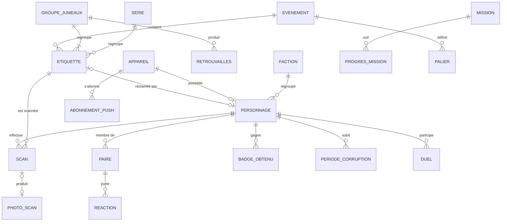
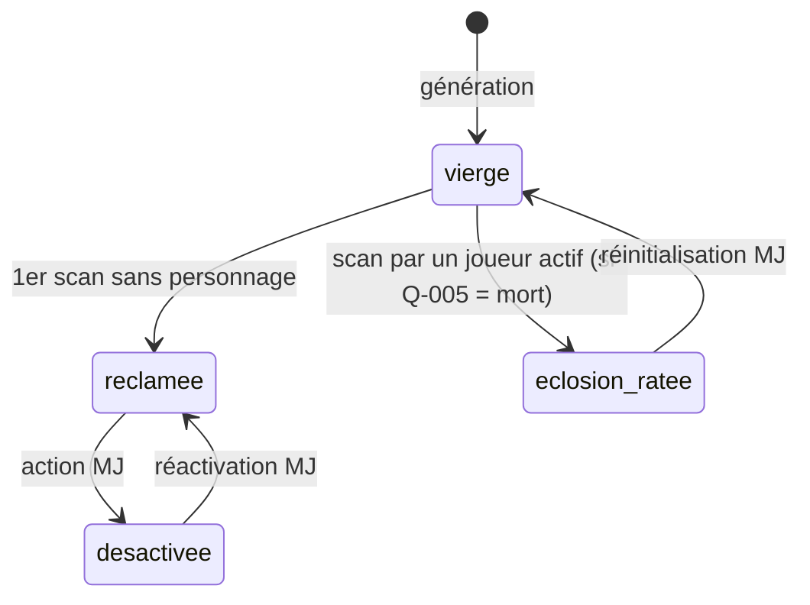
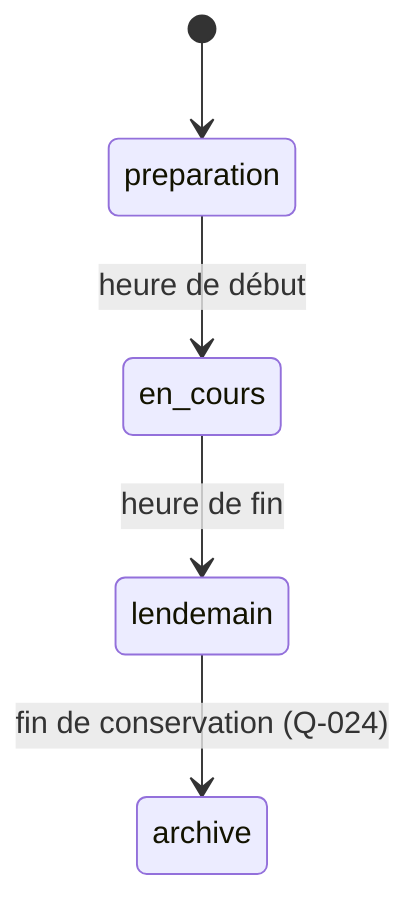

# Données

[← Index](../README.md)

Ce document décrit un **modèle logique**, indépendant de toute technologie. Les noms sont indicatifs. Le statut d'ensemble est **Proposition**, déduite des fonctionnalités confirmées ; un statut propre est indiqué pour chaque entité.

## 1. Diagramme entité-relation

*Figure : modèle logique. Statut : Proposition.*

## 2. Entités

### Evenement
Configuration de la soirée. **Statut : Hypothèse.**
| Champ | Description | Validation |
|-------|-------------|-----------|
| `debut`, `annonce_fin`, `revelation`, `fin` | Heures clés | `debut < annonce_fin < revelation ≤ fin` ; valeurs : [Q-001](questions-ouvertes.md#q-001) |
| `etat` | `preparation` → `en_cours` → `lendemain` → `archive` | Voir §3 |
| `parametres_contagion` | probabilité, durée | Modifiable en direct ([RG-008-7](fonctionnalites/chat-noir.md)) |

### Etiquette
**Statut : Confirmé** (S1, S3).
| Champ | Description | Validation / règle |
|-------|-------------|--------------------|
| `code` | Code court, par exemple `7KC3` | Unique ; [RG-001-3](fonctionnalites/etiquettes-impression.md), [RG-001-4](fonctionnalites/etiquettes-impression.md) |
| `role` | `normale`, `chat_noir`, ou autre rôle futur | [RG-001-9](fonctionnalites/etiquettes-impression.md) |
| `rarete` | `commune`, `rare`, `legendaire` | [RG-012-3](fonctionnalites/series-rarete.md) |
| `groupe_jumeaux_id` | Nullable | [FEAT-007](fonctionnalites/jumeaux.md) |
| `serie_id` | Nullable | [FEAT-012](fonctionnalites/series-rarete.md) |
| `etat` | `vierge`, `reclamee`, `eclosion_ratee` (si [Q-005](questions-ouvertes.md#q-005) le retient), `desactivee` | §3 |
| `personnage_id` | Défini quand l'étiquette est réclamée | [RG-003-3](fonctionnalites/personnage.md) |

### Appareil
Jeton anonyme stocké dans le navigateur. **Statut : Proposition.** Aucune donnée personnelle n'y est associée.

### Personnage
**Statut : Confirmé** (S1, S3).
| Champ | Description | Règle |
|-------|-------------|-------|
| `pseudo` | Généré ou saisi | [RG-003-4](fonctionnalites/personnage.md) ; modération [REQ-013](exigences-transversales.md#req-013) |
| `emoji` | Liste fermée | S1 |
| `costume.categorie` | Liste fermée | [Q-004](questions-ouvertes.md#q-004) |
| `costume.couleur` | Palette fermée | S3 |
| `costume.masque`, `.maquillage`, `.accessoires`, … | Booléens | S3 ; liste : [Q-004](questions-ouvertes.md#q-004) |
| `faction_id` | | [FEAT-011](fonctionnalites/factions.md) |
| `classe_dnd`, `caracteristiques` | Optionnels | [Q-015](questions-ouvertes.md#q-015) |
| `souvenirs` | Jauge de mémoire | [Q-012](questions-ouvertes.md#q-012) |
| `temps_app_secondes` | Cumul déclaré par le client | [RG-015-1](fonctionnalites/badges-classements.md) |
| `mots_recuperation` (empreinte) | Si [FEAT-019](fonctionnalites/recuperation.md) est retenue | Stockés sous forme hachée |

### Scan
Événement brut, jamais modifié. **Statut : Confirmé.**
`id_client` (pour l'idempotence), `scanneur_id`, `etiquette_id`, `horodatage_client`, `horodatage_serveur`, `source` (`app`, `qr_externe` ou `code_manuel`), `resultat` (`creation`, `nouvelle_carte`, `deja_vu`, `soi_meme`, `tue_dans_oeuf`, `chat_noir`, `retrouvailles`).

### Paire
Agrégat d'une paire de personnages. **Statut : Proposition.**
`personnage_min`, `personnage_max`, `premier_scan_a_vers_b`, `premier_scan_b_vers_a`, `compteur_deja_vu_a_vers_b`, `compteur_deja_vu_b_vers_a` ([RG-005-1](fonctionnalites/rescan-deja-vu.md)), `dernier_rescan_compte` ([RG-005-3](fonctionnalites/rescan-deja-vu.md)), `graine_souvenir` ([RG-006-5](fonctionnalites/faux-souvenirs.md)).

### GroupeJumeaux
**Statut : Confirmé** (S1, S3). `type` (`jumeaux` ou `triples`), `etiquettes[]` (2 ou 3), `indices_reveles`, `reuni_le`.

### Retrouvailles
Paires mutuelles validées dans la fenêtre de temps ([RG-007-7](fonctionnalites/jumeaux.md)).

### Autres entités
| Entité | Rôle | Statut |
|--------|------|--------|
| `Serie` | Nom, symbole, membres | Confirmé (S3) |
| `Faction` | Nom, score | Confirmé (S3) ; règles : [Q-014](questions-ouvertes.md#q-014) |
| `BadgeObtenu` | personnage, badge, date | Confirmé |
| `PeriodeCorruption` | personnage, début, fin, source (chat noir ou autre personnage) ; elle sert au graphe de propagation | Proposition |
| `Reaction` | auteur, carte cible, emoji | Confirmé (S3) |
| `PhotoScan` | scan, image basse qualité, consentement, masquée | Confirmé (S3) ; [Q-023](questions-ouvertes.md#q-023) |
| `Duel` | deux joueurs, état, jets, enjeu | Proposition ; [Q-015](questions-ouvertes.md#q-015) |
| `Mission`, `ProgresMission` | | Proposition |
| `Palier` | seuil, effet, atteint_le | Confirmé (principe) |
| `AbonnementPush` | appareil, abonnement Web Push | Proposition |
| `ActionMJ` | journal des actions d'administration | Proposition |

## 3. Cycles de vie

*Figure : cycle de vie d'une étiquette. Statut : Proposition, qui dépend de [Q-005](questions-ouvertes.md#q-005).*

*Figure : cycle de vie de l'événement. Statut : Proposition.*

## 4. Données dérivées
- **Collection** d'un joueur : l'ensemble des paires où il a scanné l'autre. Sa réciprocité dépend de [Q-013](questions-ouvertes.md#q-013).
- **Graphe** : les sommets sont les personnages, les arêtes les paires. Il alimente la constellation, les degrés de séparation et le classement « Pont ».
- **Progression globale** : nombre de paires ([RG-009-2](fonctionnalites/quete-collective.md)).

## 5. Conservation et suppression
Voir [REQ-014](exigences-transversales.md#req-014) et [Q-024](questions-ouvertes.md#q-024).
