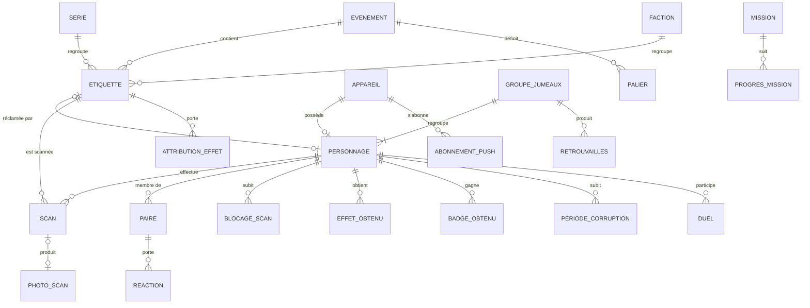
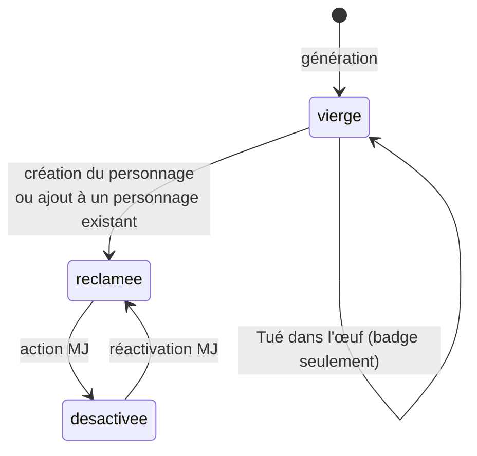
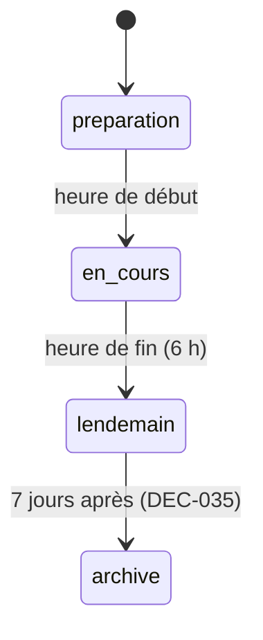

# Données

[← Index](../README.md)

Ce document décrit un **modèle logique**, indépendant de toute technologie. Les noms sont indicatifs. Le statut d'ensemble est **Proposition**, déduite des fonctionnalités confirmées ; un statut propre est indiqué pour chaque entité.

## 1. Diagramme entité-relation

*Figure : modèle logique. Statut : Proposition.*

## 2. Entités

### Evenement
Configuration de la soirée. **Statut : Hypothèse.**
| Champ | Description | Validation |
|-------|-------------|-----------|
| `debut`, `debut_jeu`, `jumeaux_complets`, `annonce_fin`, `revelation`, `fin` | Heures clés : 21 h, minuit, 2 h, H−30, 5 h, 6 h | `debut ≤ debut_jeu < jumeaux_complets < annonce_fin < revelation < fin` ([DEC-018](decisions.md#dec-018)) |
| `parametres_jumeaux` | cible de paires et de triplés, seuil d'activations (60), intervalle des indices (10 min), fenêtre (90 s) | [FEAT-007](fonctionnalites/jumeaux.md) |
| `etat` | `preparation` → `en_cours` → `lendemain` → `archive` | Voir §3 |
| `parametres_contagion` | ratio de chats noirs (1/50), probabilité (60 %), durée (10 min), immunité (80 % ; 20/40/60 min), seuil de dégressivité (50 %) | Modifiable en direct ([RG-008-7](fonctionnalites/chat-noir.md)) |

### Etiquette
**Statut : Confirmé** (S1, S3).
| Champ | Description | Validation / règle |
|-------|-------------|--------------------|
| `code` | Code court, par exemple `7KC3` | Unique ; [RG-001-3](fonctionnalites/etiquettes-impression.md), [RG-001-4](fonctionnalites/etiquettes-impression.md) |
| `role` | `normale`, `personnelle_mj`, `speciale_mj` (légendaire ou piège selon le mélange en cours) | [RG-001-9](fonctionnalites/etiquettes-impression.md), [FEAT-022](fonctionnalites/costume-mj.md) |
| `faction_id` | Tirée au hasard à la réclamation, non modifiable | [FEAT-011](fonctionnalites/factions.md) |
| `rarete` | `commune`, `rare`, `legendaire` | [RG-012-3](fonctionnalites/series-rarete.md) |
| `serie_id` | Nullable | [FEAT-012](fonctionnalites/series-rarete.md) |
| `etat` | `vierge`, `reclamee`, `desactivee` | §3 |
| `format` | `petit` ou `grand` | [RG-001-14](fonctionnalites/etiquettes-impression.md) |
| `personnage_id` | Défini quand l'étiquette est réclamée ; un personnage peut avoir plusieurs étiquettes | [RG-003-3](fonctionnalites/personnage.md) |

### Appareil
Jeton anonyme stocké dans le navigateur. **Statut : Proposition.** Aucune donnée personnelle n'y est associée. Plusieurs appareils peuvent être liés au même personnage après une réintégration par PIN ([FEAT-019](fonctionnalites/recuperation.md)). Le stockage local n'est qu'un cache : le serveur est la source de vérité ([DEC-052](decisions.md#dec-052)).

### Personnage
**Statut : Confirmé** (S1, S3).
| Champ | Description | Règle |
|-------|-------------|-------|
| `pseudo` | Généré ou saisi | [RG-003-4](fonctionnalites/personnage.md) ; modération [REQ-013](exigences-transversales.md#req-013) |
| `emoji` | Emoji du type de costume (pas de choix séparé) | S8 |
| `costume.type` | 8 types fermés | [FEAT-003](fonctionnalites/personnage.md) |
| `costume.couleur` | Couleur dominante, 12 choix ; sans lien avec la faction | [DEC-059](decisions.md#dec-059) |
| `costume.attributs` | 12 booléens | [FEAT-003](fonctionnalites/personnage.md) ; figés à minuit |
| `classe_dnd`, `caracteristiques` | Classe choisie ; caractéristiques tirées du costume | [DEC-030](decisions.md#dec-030) |
| `souvenirs` | Jauge de mémoire | [DEC-031](decisions.md#dec-031) |
| `temps_app_secondes` | Cumul déclaré par le client, envoyé régulièrement, plafonné par le serveur | [RG-015-4](fonctionnalites/badges-classements.md) |
| `pin` (empreinte) | Code à 4 chiffres, stocké haché | [FEAT-019](fonctionnalites/recuperation.md) |
| `groupe_jumeaux_id` | Nullable ; attribué pendant la soirée | [FEAT-007](fonctionnalites/jumeaux.md) |
| `chat_noir` | Booléen secret, communiqué au joueur concerné | [FEAT-008](fonctionnalites/chat-noir.md) |
| `photos_revelation` | Autorise l'usage de ses photos à la révélation | [DEC-061](decisions.md#dec-061) |
| `surconsommation` | Plus de 3 étiquettes : malus actifs | [RG-003-10](fonctionnalites/personnage.md) |
| `faction_finale_id` | Faction de rattachement en fin de partie | [RG-011-6](fonctionnalites/factions.md) |
| `etat_contagion`, `immunise_jusqu_a` | Sain, corrompu ou immunisé | [FEAT-008](fonctionnalites/chat-noir.md) |
| `est_mj`, `est_spectateur` | Exclusions des rôles secrets | [RG-022-7](fonctionnalites/costume-mj.md) |

### Scan
Événement brut, jamais modifié. **Statut : Confirmé.**
`id_client` (pour l'idempotence), `scanneur_id`, `etiquette_id`, `horodatage_client`, `horodatage_serveur`, `source` (`app`, `qr_externe` ou `code_manuel`), `resultat` (`creation`, `ajout_etiquette`, `nouvelle_carte`, `deja_vu`, `soi_meme`, `tue_dans_oeuf`, `chat_noir`, `retrouvailles`, `legendaire`, `piege`, `bloque`, `spectateur`).

### Paire
Agrégat d'une paire de personnages. **Statut : Proposition.**
`personnage_min`, `personnage_max`, `premier_scan_a_vers_b`, `premier_scan_b_vers_a`, `compteur_deja_vu_a_vers_b`, `compteur_deja_vu_b_vers_a` ([RG-005-1](fonctionnalites/rescan-deja-vu.md)), `dernier_rescan_compte` ([RG-005-3](fonctionnalites/rescan-deja-vu.md)), `graine_souvenir` ([RG-006-5](fonctionnalites/faux-souvenirs.md)).

### GroupeJumeaux
**Statut : Confirmé** (S1, S3, S5). `type` (`jumeaux` ou `triples`), `personnages[]` (2 ou 3), `forme_le`, `indices_reveles`, `reuni_le`.

### Retrouvailles
Paires mutuelles validées dans la fenêtre de temps ([RG-007-7](fonctionnalites/jumeaux.md)).

### Autres entités
| Entité | Rôle | Statut |
|--------|------|--------|
| `Serie` | Nom, symbole, membres | Confirmé (S3) |
| `Faction` | Nom, couleur d'interface, devise, score | Confirmé (S3, S5, S7) ; 5 factions ([FEAT-011](fonctionnalites/factions.md)) |
| `BlocageScan` | personnage, cause (piège ou surconsommation), début, fin | Confirmé (S5, S7) |
| `AttributionEffet` | étiquette spéciale, effet (L-x ou T-x), début, fin ; renouvelée toutes les 20 min | Confirmé (S7) |
| `EffetObtenu` | personnage, effet, date ; un effet ne s'obtient qu'une fois | Confirmé (S7) |
| `ExemplaireLimite` | effet L-7, heure de mise en rayon (21 h, minuit, 3 h), obtenu_par | Confirmé (S7) |
| `BadgeObtenu` | personnage, badge, date | Confirmé |
| `PeriodeCorruption` | personnage, début, fin, source (chat noir ou autre personnage) ; elle sert au graphe de propagation | Proposition |
| `Reaction` | auteur, carte cible, emoji | Confirmé (S3) |
| `PhotoScan` | scan, image basse qualité, consentement du scanneur, masquée | Confirmé (S3, S5, S7) |
| `Duel` | deux joueurs, état, jets, enjeu | Proposition ; hors périmètre de samedi |
| `Mission`, `ProgresMission` | | Proposition |
| `Palier` | seuil, effet, atteint_le | Confirmé (principe) |
| `AbonnementPush` | appareil, abonnement Web Push | Proposition |
| `ActionMJ` | journal des actions d'administration | Proposition |

## 3. Cycles de vie

*Figure : cycle de vie d'une étiquette ordinaire. Les étiquettes spéciales et l'étiquette personnelle du MJ sont actives dès la génération. Statut : Confirmé (S5, S7).*

*Figure : cycle de vie de l'événement. Statut : Proposition.*

## 4. Données dérivées
- **Collection** d'un joueur : l'ensemble des personnages qu'il a scannés, par n'importe laquelle de leurs étiquettes. Elle n'est pas réciproque ([DEC-025](decisions.md#dec-025)).
- **Graphe** : les sommets sont les personnages, les arêtes les paires. Il alimente la constellation, les degrés de séparation et le classement « Pont ».
- **Progression globale** : nombre de paires ([RG-009-2](fonctionnalites/quete-collective.md)).

## 5. Conservation et suppression
7 jours après la fête : suppression des photos et anonymisation du reste ([DEC-035](decisions.md#dec-035), [REQ-014](exigences-transversales.md#req-014)).
