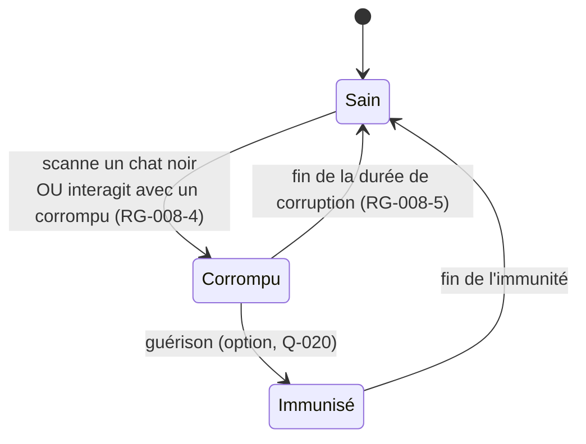

# FEAT-008 : Chats noirs et glitch contagieux

[← Fonctionnalités](README.md)

**Statut :** Confirmé · **Sources :** S1 (« Excellent !!! »), S2, S3 (« exceptionnelle ! »)

## Objectif
Clin d'œil à *Matrix*, où un déjà vu signale un bug dans la Matrice. Deux ou trois étiquettes **légendaires, très rares**, font **glitcher** l'interface pendant quelques secondes (S1). Le glitch est **contagieux** : il se propage par les scans (S3).

## États d'un joueur

*Figure : modèle de contagion proposé, de type épidémiologique. Statut : Proposition. Seul le principe de contagion est Confirmé.*

## Règles métier
| ID | Règle | Statut |
|----|-------|--------|
| RG-008-1 | Il y a 2 ou 3 chats noirs pour toute la soirée. | Confirmé (S1) ; nombre final : [Q-020](../questions-ouvertes.md#q-020) |
| RG-008-2 | Scanner un chat noir déclenche un **glitch visuel** de quelques secondes et donne une carte légendaire. | Confirmé (S1) |
| RG-008-3 | Le joueur qui le scanne devient **corrompu**. | Confirmé (S3 : « glitch contagieux ») |
| RG-008-4 | Un joueur corrompu **transmet** la corruption. Sens de transmission (scanneur → scanné, scanné → scanneur, ou les deux) : À préciser. | Confirmé (principe) ; [Q-020](../questions-ouvertes.md#q-020) |
| RG-008-5 | La corruption dure un temps limité, 10 minutes par exemple. | Proposition (S2) |
| RG-008-6 | Il faut **contrôler le rythme de contagion** : trop rapide, tout le monde l'a ; trop lent, elle disparaît. | Confirmé (S3) |
| RG-008-7 | Le MJ peut **régler la contagion en direct** (probabilité de transmission, durée) et relancer un foyer. | Proposition, qui répond à RG-008-6 |
| RG-008-8 | Cible d'équilibrage : garder entre X % et Y % de joueurs actifs corrompus. | À préciser ([Q-020](../questions-ouvertes.md#q-020)) |
| RG-008-9 | Le graphe de propagation apparaît lors de la révélation finale ([FEAT-009](quete-collective.md)). | Proposition (S2) |
| RG-008-10 | Le glitch respecte [REQ-003](../exigences-transversales.md#req-003) : pas de flash dangereux, et réduction des animations respectée. | Proposition, requise pour la sécurité |

> **Note d'équilibrage (Proposition).** Si chaque corrompu fait en moyenne `s` scans par minute pendant `d` minutes, avec une probabilité de transmission `p`, le taux de reproduction vaut `R ≈ p × s × d`. Viser `R` légèrement supérieur à 1 au début, puis l'ajuster selon le tableau de bord. Les valeurs réelles de `s` ne seront connues que pendant la soirée, d'où le réglage en direct.

## Propositions non validées (S2)
- **L'Agent :** une étiquette ultra-rare qui réécrit au hasard un souvenir chez ceux qui la scannent.
- **Chat noir horaire :** actif seulement sur une plage, par exemple de 1 h 00 à 1 h 13.
- **Copie pirate :** un QR photographié et réutilisé de façon anormale déclenche un glitch spécial ([REQ-012](../exigences-transversales.md#req-012)).

## Critères d'acceptation
- **CA-008-1 :** Étant donné un joueur sain, quand il scanne un chat noir, alors il voit le glitch, reçoit la carte légendaire et passe à « corrompu ».
- **CA-008-2 :** Étant donné un joueur corrompu, quand la durée de corruption s'écoule, alors il redevient sain sans action de sa part.
- **CA-008-3 :** Étant donné une probabilité de transmission modifiée par le MJ, alors les scans suivants appliquent la nouvelle valeur.
- **CA-008-4 :** Le glitch ne produit jamais plus de 3 flashs par seconde.
