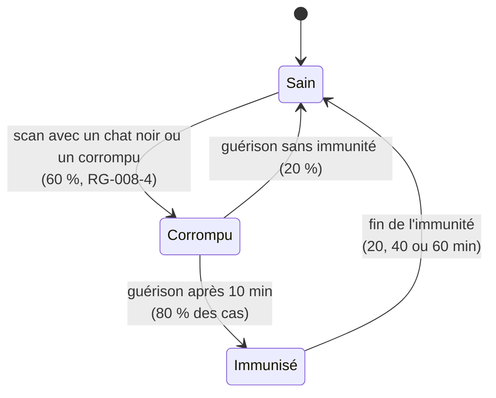

# FEAT-008 : Chats noirs et glitch contagieux

[← Fonctionnalités](README.md)

**Statut :** Confirmé · **Sources :** S1 (« Excellent !!! »), S2, S3 (« exceptionnelle ! »), S5, S7

## Objectif
Clin d'œil à *Matrix*, où un déjà vu signale un bug dans la Matrice. Les chats noirs font **glitcher** l'interface pendant quelques secondes (S1). Le glitch est **contagieux** : il se propage par les scans (S3).

« Chat noir » est un **rôle secret attribué dynamiquement à des joueurs**, en nombre proportionnel aux joueurs : 1 pour 50, soit 6 à 8 pour 300 à 400 joueurs (Confirmé, S5, S7, [DEC-067](../decisions.md#dec-067)). Cela remplace les 2 ou 3 étiquettes légendaires de S1.

Le joueur désigné **est prévenu** : « Tu es un chat noir. Ne le dis à personne. » L'app l'incite aussitôt à contaminer du monde, par exemple : « Infecte 3 personnes dans les 10 prochaines minutes. » Comme au Loup-garou, il peut jouer son rôle.

## États d'un joueur

*Figure : modèle de contagion. Statut : Confirmé (S5) ; valeurs réglables en direct.*

## Règles métier
| ID | Règle | Statut |
|----|-------|--------|
| RG-008-1 | Il y a **1 chat noir pour 50 joueurs actifs** ; de nouveaux chats noirs sont désignés parmi les joueurs à mesure que les joueurs arrivent. Le MJ et les spectateurs sont exclus. | Confirmé (S5, S7) |
| RG-008-1b | Le chat noir est prévenu de son rôle et incité à contaminer dès qu'il l'apprend. Il reste contagieux toute la soirée et ne guérit pas. | Confirmé (S7) ; « ne guérit pas » : Proposition |
| RG-008-2 | Scanner un chat noir, ou être scanné par lui, déclenche un **glitch visuel** de quelques secondes chez la personne contaminée. | Confirmé (S1, S5) |
| RG-008-3 | Le joueur qui le scanne devient **corrompu** avec une probabilité de 60 %. | Confirmé (S3, S5) |
| RG-008-4 | Un joueur corrompu **transmet** la corruption dans **les deux sens** : quand il scanne ou quand il se fait scanner, avec une probabilité de **60 %**. | Confirmé (S5) |
| RG-008-5 | La corruption dure **10 minutes**, puis guérison automatique. | Confirmé (S5) |
| RG-008-5b | À la guérison, le joueur est **immunisé dans 80 % des cas**. Parmi les immunisés : 80 % le restent 20 min, 10 % 40 min, 10 % 60 min. Ensuite, il peut de nouveau être corrompu. | Confirmé (S5) |
| RG-008-5d | Un joueur en **surconsommation** (plus de 3 étiquettes) est corrompu immédiatement et ne peut plus être immunisé ([RG-003-10](personnage.md)). | Confirmé (S7) |
| RG-008-5c | Quand plus de **50 % des joueurs actifs** sont corrompus, la durée de corruption **diminue progressivement**, pour éviter une épidémie totale. Proposition de courbe : −1 min par tranche de 5 points au-dessus de 50 %, minimum 3 min. | Confirmé (principe, S5) ; courbe : Proposition |
| RG-008-6 | Il faut **contrôler le rythme de contagion** : trop rapide, tout le monde l'a ; trop lent, elle disparaît. | Confirmé (S3) |
| RG-008-7 | Le MJ peut **régler la contagion en direct** (probabilité de transmission, durée) et relancer un foyer. | Proposition, qui répond à RG-008-6 |
| RG-008-8 | Cible d'équilibrage : ne pas dépasser durablement 50 % de joueurs corrompus (RG-008-5c). Seuil bas : à préciser. | Confirmé (S5) |
| RG-008-9 | Le graphe de propagation apparaît lors de la révélation finale ([FEAT-009](quete-collective.md)). | Proposition (S2) |
| RG-008-10 | Le glitch respecte [REQ-003](../exigences-transversales.md#req-003) : pas de flash dangereux, et réduction des animations respectée. | Proposition, requise pour la sécurité |

> **Note d'équilibrage (Proposition).** Si chaque corrompu fait en moyenne `s` scans par minute pendant `d` minutes, avec une probabilité de transmission `p`, le taux de reproduction vaut `R ≈ p × s × d`. Viser `R` légèrement supérieur à 1 au début, puis l'ajuster selon le tableau de bord. Les valeurs réelles de `s` ne seront connues que pendant la soirée, d'où le réglage en direct.

## Propositions non validées (S2)
- **L'Agent :** une étiquette ultra-rare qui réécrit au hasard un souvenir chez ceux qui la scannent.
- **Chat noir horaire :** actif seulement sur une plage, par exemple de 1 h 00 à 1 h 13.
- **Copie pirate :** un QR photographié et réutilisé de façon anormale déclenche un glitch spécial ([REQ-012](../exigences-transversales.md#req-012)).

## Critères d'acceptation
- **CA-008-1 :** Étant donné un joueur sain et une probabilité de transmission forcée à 100 %, quand il scanne un chat noir, alors il voit le glitch et passe à « corrompu ».
- **CA-008-2 :** Étant donné un joueur corrompu, quand la durée de corruption s'écoule, alors il redevient sain sans action de sa part.
- **CA-008-3 :** Étant donné une probabilité de transmission modifiée par le MJ, alors les scans suivants appliquent la nouvelle valeur.
- **CA-008-4 :** Le glitch ne produit jamais plus de 3 flashs par seconde.
- **CA-008-5 :** Étant donné 60 % de joueurs corrompus, alors une nouvelle corruption dure moins de 10 min.
