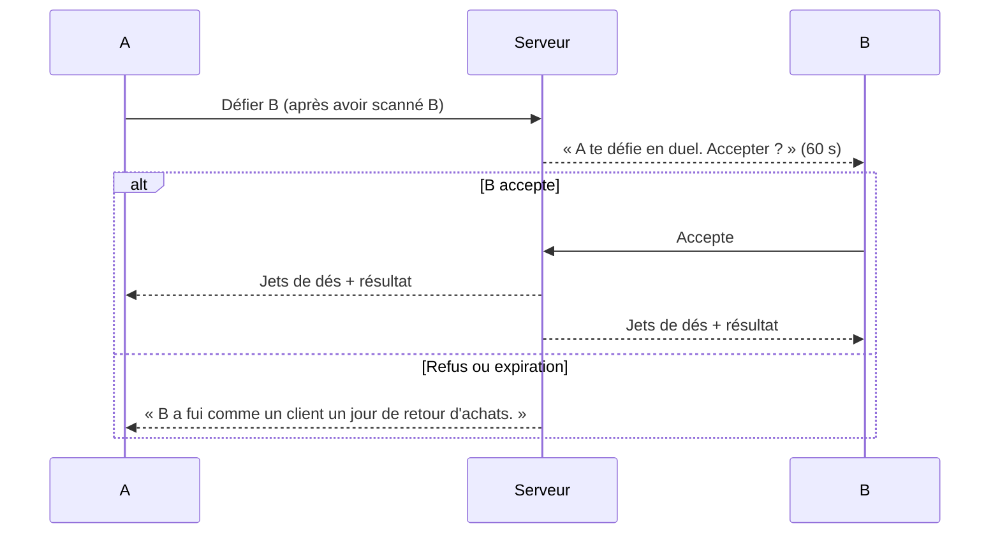

# FEAT-010 : Comparaison, degrés de séparation et duel D&D

[← Fonctionnalités](README.md)

**Statut :** Confirmé (comparaison, degrés) ; Confirmé sous consentement (duel) · **Sources :** S1, S2, S3

## Objectif
Permettre à **la personne qui scanne de se comparer à la personne scannée** (S1). Mettre en valeur le « déjà vu social » : les personnes qu'on a croisées tous les deux. Proposer en plus un **duel façon D&D**, si les deux joueurs sont d'accord (S3).

## 10.1 Comparaison (écran de résultat)
| ID | Règle | Statut |
|----|-------|--------|
| RG-010-1 | Après un scan, le scanneur voit ses stats à côté de celles du scanné : collection, déjà-vus, badges, faction. | Confirmé (S1, S3 « génial ») ; liste exacte : Proposition |
| RG-010-2 | L'écran affiche les **connaissances communes** : « Vous avez déjà vu les mêmes N personnes », avec leurs avatars. | Confirmé (S2 → S3) |
| RG-010-3 | La comparaison ne montre que des données publiques ([REQ-009](../exigences-transversales.md#req-009)). | Proposition |

## 10.2 Degrés de séparation et clans
| ID | Règle | Statut |
|----|-------|--------|
| RG-010-4 | Afficher le plus court chemin entre deux joueurs : « Vous êtes reliés par Batgirl → Le Moine → toi ». | Confirmé (« intéressant », S3) |
| RG-010-5 | Les degrés permettent de **repérer des clans** : des groupes de joueurs fortement connectés. | Hypothèse (S3 : « ça peut permettre éventuellement de connaître un peu les clans ») ; lien avec les factions : [Q-014](../questions-ouvertes.md#q-014) |

## 10.3 Duel D&D
| ID | Règle | Statut |
|----|-------|--------|
| RG-010-6 | Un duel n'a lieu que si **les deux personnes ont donné leur accord**. | Confirmé (S3) |
| RG-010-7 | Mécanique : jets de d20 virtuels, modifiés par des caractéristiques tirées du costume (par exemple, « Charisme vestimentaire » +2 si accessoires). | Proposition |
| RG-010-8 | Enjeu du duel : souvenirs, points de faction ou titre seulement ? | À préciser ([Q-015](../questions-ouvertes.md#q-015)) |
| RG-010-9 | Le consentement passe par un scan mutuel ou par un bouton « J'accepte le duel » chez l'autre, avec une expiration de 60 s. | Proposition |
| RG-010-10 | Limite de duels entre les mêmes joueurs, pour éviter l'acharnement : un par heure. | Proposition |

*Figure : flux de duel. Statut : Proposition, construite sur la règle confirmée du consentement.*

Pour que B reçoive la demande, B doit avoir l'app ouverte ([FEAT-016](notifications.md)). Le plus simple est que A et B soient face à face.

## Critères d'acceptation
- **CA-010-1 :** Étant donné que A scanne B, alors l'écran montre les stats des deux et le nombre exact de personnages présents dans les deux collections.
- **CA-010-2 :** Étant donné A et B reliés dans le graphe, alors le chemin affiché est un plus court chemin.
- **CA-010-3 :** Étant donné un défi, quand B ne répond pas dans le délai, alors aucun jet n'a lieu et aucun enjeu ne change de main.
- **CA-010-4 :** Aucun duel ne peut se résoudre sans une action explicite des deux joueurs.
