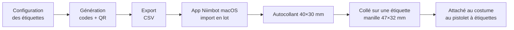

# FEAT-001 : Étiquettes uniques et impression

[← Fonctionnalités](README.md)

**Statut :** Confirmé (principe) ; Hypothèse pour la chaîne d'impression · **Sources :** S1, S3, S4, S5, S7

## Objectif
Produire des étiquettes physiques **uniques** qui forment le costume de Florian, qu'il peut distribuer, et qui se scannent de façon fiable dans une salle sombre.

## Utilisateurs
Florian (préparation), tous les joueurs (lecture).

## Périmètre
- **Inclus :** génération des codes, des URL et des QR ; rôles d'étiquette fixés avant la fête (personnelle du MJ, légendaire, piège, série) ; export CSV pour l'import en lot de l'app Niimbot ; impression sur la B1 (203 dpi), en **deux formats** : environ 690 petits autocollants et plus de 200 étiquettes plus grandes ([DEC-066](../decisions.md#dec-066)). Les jumeaux, triplés et chats noirs sont attribués pendant la soirée, aux joueurs.
- **Exclu :** commande d'étiquettes supplémentaires.

## Règles métier
| ID | Règle | Statut | Source |
|----|-------|--------|--------|
| RG-001-1 | Chaque étiquette a un identifiant **unique**. | Confirmé | S1 |
| RG-001-2 | Le QR encode une **URL courte** `https://p.uyt.re/<code>`, pour limiter la densité du QR. | Confirmé | S3 |
| RG-001-3 | Le code fait **4 caractères alphanumériques** (exemple `7KC3`). | Hypothèse : longueur déduite de l'exemple de S3 | S3 |
| RG-001-4 | L'alphabet du code exclut les caractères ambigus (`0/O`, `1/I/L`). | Proposition | — |
| RG-001-5 | Le QR mesure **un pouce (25,4 mm) de large**. | Confirmé | S3 |
| RG-001-6 | Impression **noir sur blanc**, sur étiquette **mate**. | Confirmé | S3 |
| RG-001-7 | Le **code court** est imprimé sous le QR, en clair, comme secours. | Confirmé | S3 |
| RG-001-8 | Le QR ne révèle pas le rôle de l'étiquette : un chat noir ne doit pas se reconnaître à son QR ni à son code. | Proposition | — |
| RG-001-9 | Le rôle d'une étiquette (légendaire, piège, série…) se définit **en configuration** ; on peut le modifier sans réimprimer. Jumeaux et chats noirs ne sont plus des rôles d'étiquette ([DEC-021](../decisions.md#dec-021)). | Confirmé (S1, S5) | S1, S5 |
| RG-001-12 | L'étiquette manille porte seulement le QR et le logo, sans verso. | Confirmé (S5, [DEC-044](../decisions.md#dec-044)) | S5 |
| RG-001-13 | Une étiquette est jouable dès qu'on la scanne ; il n'y a pas d'activation par le MJ. | Confirmé (S7, [DEC-063](../decisions.md#dec-063)) | S7 |
| RG-001-14 | Le grand format sert aux étiquettes du costume du MJ (personnelle, légendaires, pièges) ; le reste du grand format est distribué comme les petites. Le gabarit est décliné pour les deux formats. | Confirmé (S7) | S7 |
| RG-001-10 | Le visuel de l'étiquette parodie une étiquette de vêtement (taille, composition, entretien, prix soldé). | Proposition, alignée sur l'univers mode (S3) | S2, S3 |
| RG-001-11 | Le niveau de correction d'erreur du QR est élevé (M ou Q) tout en gardant les modules lisibles à 25 mm. | Proposition | — |

## Chaîne d'impression (import CSV confirmé, [DEC-028](../decisions.md#dec-028))

*Figure : chaîne d'impression supposée, à partir du matériel acheté (S4). Statut : Hypothèse. Le recto/verso, l'assemblage et le traitement par lot dans l'app Niimbot restent à vérifier.*

## Données
- **Crée :** `Etiquette` ([données](../donnees.md#etiquette)).
- **Lit :** configuration des groupes ([`GroupeJumeaux`](../donnees.md#groupejumeaux)), séries et factions.

## Critères d'acceptation
- **CA-001-1 :** Étant donné N étiquettes générées, alors les N codes sont distincts et chaque URL répond.
- **CA-001-2 :** Étant donné une étiquette imprimée, quand on la scanne avec un iPhone et un Android récents sous faible éclairage (lampe de poche du téléphone allumée), alors l'URL s'ouvre en moins de 3 secondes de visée. Test informel avec les téléphones disponibles ([DEC-051](../decisions.md#dec-051)).
- **CA-001-3 :** Saisir le code court dans l'app mène à la même étiquette que le QR.
- **CA-001-4 :** Changer le rôle d'une étiquette en configuration ne change ni son code ni son QR.

## Dépendances et questions
Quantité : environ 800 autocollants pour 300 à 400 joueurs, un joueur pouvant avoir plusieurs étiquettes ([DEC-019](../decisions.md#dec-019)). Formats : petit (40×30 mm) et grand (dimensions à mesurer).
