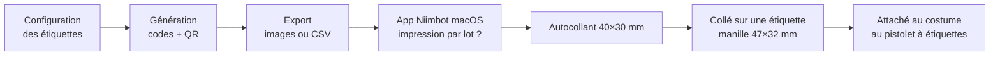

# FEAT-001 : Étiquettes uniques et impression

[← Fonctionnalités](README.md)

**Statut :** Confirmé (principe) ; Hypothèse pour la chaîne d'impression · **Sources :** S1, S3, S4

## Objectif
Produire des étiquettes physiques **uniques** qui forment le costume de Florian, qu'il peut distribuer, et qui se scannent de façon fiable dans une salle sombre.

## Utilisateurs
Florian (préparation), tous les joueurs (lecture).

## Périmètre
- **Inclus :** génération des codes, des URL et des QR ; attribution des rôles d'étiquette (normale, jumelle, chat noir, série, faction…) ; export prêt à imprimer ; impression sur la Niimbot.
- **Exclu :** commande d'étiquettes supplémentaires.

## Règles métier
| ID | Règle | Statut | Source |
|----|-------|--------|--------|
| RG-001-1 | Chaque étiquette a un identifiant **unique**. | Confirmé | S1 |
| RG-001-2 | Le QR encode une **URL courte** `https://p.uyt.re/<code>`, pour limiter la densité du QR. | Confirmé | S3 |
| RG-001-3 | Le code fait **4 caractères alphanumériques** (exemple `7KC3`). | Hypothèse : longueur déduite de l'exemple de S3 | S3 |
| RG-001-4 | L'alphabet du code exclut les caractères ambigus (`0/O`, `1/I/L`). | Proposition | — |
| RG-001-5 | Le QR mesure **un pouce (25,4 mm) de large**. | Confirmé | S3 |
| RG-001-6 | Impression **noir sur blanc**, sur étiquette **mate**. | Confirmé | S3 |
| RG-001-7 | Le **code court** est imprimé sous le QR, en clair, comme secours. | Confirmé | S3 |
| RG-001-8 | Le QR ne révèle pas le rôle de l'étiquette : un chat noir ne doit pas se reconnaître à son QR ni à son code. | Proposition | — |
| RG-001-9 | Le rôle d'une étiquette (jumelle, chat noir, série…) se définit **en configuration** ; on peut le modifier avant la fête sans réimprimer. | Confirmé pour les jumeaux (« jumeaux as code », S1) ; Proposition pour les autres rôles | S1 |
| RG-001-10 | Le visuel de l'étiquette parodie une étiquette de vêtement (taille, composition, entretien, prix soldé). | Proposition, alignée sur l'univers mode (S3) | S2, S3 |
| RG-001-11 | Le niveau de correction d'erreur du QR est élevé (M ou Q) tout en gardant les modules lisibles à 25 mm. | Proposition | — |

## Chaîne d'impression (Hypothèse à valider, [Q-007](../questions-ouvertes.md#q-007))

*Figure : chaîne d'impression supposée, à partir du matériel acheté (S4). Statut : Hypothèse. Le recto/verso, l'assemblage et le traitement par lot dans l'app Niimbot restent à vérifier.*

## Données
- **Crée :** `Etiquette` ([données](../donnees.md#etiquette)).
- **Lit :** configuration des groupes ([`GroupeJumeaux`](../donnees.md#groupejumeaux)), séries et factions.

## Critères d'acceptation
- **CA-001-1 :** Étant donné N étiquettes générées, alors les N codes sont distincts et chaque URL répond.
- **CA-001-2 :** Étant donné une étiquette imprimée, quand on la scanne avec un iPhone et un Android récents sous faible éclairage (lampe de poche du téléphone allumée), alors l'URL s'ouvre en moins de 3 secondes de visée. Le protocole de test reste à définir ([Q-008](../questions-ouvertes.md#q-008)).
- **CA-001-3 :** Saisir le code court dans l'app mène à la même étiquette que le QR.
- **CA-001-4 :** Changer le rôle d'une étiquette en configuration ne change ni son code ni son QR.

## Dépendances et questions
[Q-002](../questions-ouvertes.md#q-002) (quantité), [Q-007](../questions-ouvertes.md#q-007) (impression par lot), [Q-008](../questions-ouvertes.md#q-008) (tests), [Q-019](../questions-ouvertes.md#q-019) (impression des séries).
