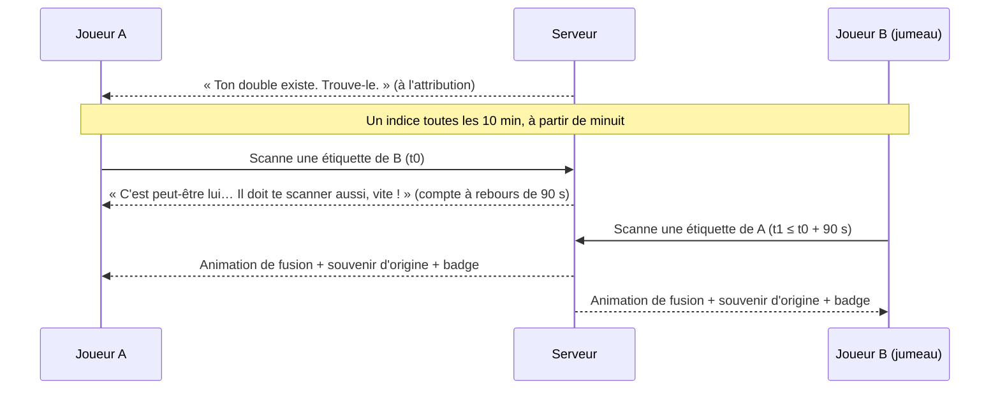

# FEAT-007 : Jumeaux, triplés et retrouvailles

[← Fonctionnalités](README.md)

**Statut :** Confirmé · **Sources :** S1, S3, S5, S6, S7

## Objectif
Certains **joueurs** sont liés à un ou deux autres (jumeaux ou triplés). Ils doivent **se retrouver dans la foule** et **se rencontrer** (S3). C'est le moment fort de la soirée et un excellent moteur de conversation.

Un jumeau est une **personne**, pas une étiquette (Confirmé, S5, S6). Comme un joueur peut porter plusieurs étiquettes, scanner **n'importe laquelle** de ses étiquettes compte pour le trouver.

## Attribution dynamique (Confirmé, S5, S6, [DEC-021](../decisions.md#dec-021), [DEC-055](../decisions.md#dec-055))
Les groupes ne sont **pas configurés à l'avance**. Le serveur les forme pendant la soirée :
- **Cible :** 45 paires de jumeaux et une dizaine de groupes de triplés, soit environ 120 joueurs.
- **Début :** à la 60e activation ou à minuit, au premier des deux. Les premiers joueurs ne doivent pas recevoir de jumeau trop vite.
- **Progressivité :** les groupes sont formés au fil des activations, de façon étalée.
- **Échéance :** à **2 h**, tous les groupes sont formés et le jeu est entièrement jouable. Si les activations ne suffisent pas, le serveur complète avec des joueurs déjà actifs.
- **Exclus :** le MJ et les spectateurs.

Algorithme retenu : courbe linéaire (Confirmé, S7, [DEC-071](../decisions.md#dec-071)). À chaque déclenchement (nouvelle activation, ou tick toutes les 5 min), le serveur calcule le nombre de groupes qu'il « devrait » avoir formés à cet instant sur une courbe linéaire allant de l'heure de départ à 2 h. S'il est en retard, il forme un groupe avec le nouveau joueur et un joueur actif sans jumeau, tiré au hasard parmi ceux qui ont créé leur personnage depuis au moins 10 min.

## Parcours nominal

*Figure : retrouvailles par scan mutuel. Statut : Confirmé (règle S3, valeurs S5) ; textes : Proposition.*

## Règles métier
| ID | Règle | Statut |
|----|-------|--------|
| RG-007-1 | Un groupe compte 2 joueurs (jumeaux) ou 3 (triplés). Le lien porte sur les **personnages**, pas sur les étiquettes. | Confirmé (S5, S6) |
| RG-007-2 | 45 paires et une dizaine de triplés. | Confirmé (S5) |
| RG-007-3 | Le joueur apprend qu'il a un double au moment de l'attribution (bannière et notification), et peut revoir ses indices sur sa fiche ou en scannant sa propre étiquette. | Confirmé (S1) ; canal d'annonce : Proposition |
| RG-007-4 | **Indices progressifs** : ils sont tirés des attributs de costume du jumeau ([FEAT-003](personnage.md)) et révélés au fil du temps. | Confirmé (S3) |
| RG-007-5 | Ordre des indices : type de costume, puis un attribut à la fois (vrai ou faux), puis emoji, puis pseudo. | Proposition |
| RG-007-6 | Un indice toutes les **10 minutes**, **seulement à partir de minuit**. Un joueur qui reçoit son jumeau après minuit reçoit son premier indice tout de suite. | Confirmé (S5) ; rattrapage : Proposition |
| RG-007-7 | Les **retrouvailles** exigent un **scan mutuel** dans une fenêtre de **90 secondes**. | Confirmé (S3, S5) |
| RG-007-8 | Hors de la fenêtre, le premier scan compte comme un scan normal ; la fenêtre redémarre au prochain scan entre les deux. | Proposition |
| RG-007-9 | Les deux joueurs voient l'animation de retrouvailles **au même moment**, au second scan. | Confirmé (S3) |
| RG-007-10 | Les retrouvailles donnent un **badge « Jumeaux retrouvés »**. | Confirmé (S3) |
| RG-007-11 | Pour des triplés, les retrouvailles complètes exigent les 3 paires mutuelles. Les retrouvailles partielles (2 sur 3) donnent un badge intermédiaire. | Proposition |
| RG-007-12 | Le premier groupe réuni de la soirée obtient un titre au classement ([FEAT-015](badges-classements.md)). | Proposition (S2) |
| RG-007-13 | Si A avait **déjà scanné** son jumeau avant l'attribution, A est **averti** : « Tu as déjà croisé ton double ! » Les retrouvailles exigent tout de même un nouveau scan mutuel. | Confirmé (S6) ; texte : Proposition |
| RG-007-14 | La description du costume est figée à minuit, pour que les indices restent justes ([DEC-041](../decisions.md#dec-041)). | Confirmé (S5) |

## Variantes
| Cas | Comportement |
|-----|--------------|
| Le jumeau ne se présente jamais | Les indices continuent jusqu'au pseudo ; à la fin, « Ton double a fui la Matrice. » (Proposition) |
| Le jumeau porte plusieurs étiquettes | N'importe laquelle compte, y compris pour le scan mutuel (Confirmé, S6) |
| A a déjà scanné B avant l'attribution | Avertissement RG-007-13 ; pas de retrouvailles automatiques |

## Interface
Après le premier scan de la paire : compte à rebours bien visible, avec le message « Fais-toi scanner par ton double ! ». Les deux joueurs voient l'animation de fusion des deux cartes.

## Critères d'acceptation
- **CA-007-1 :** Étant donné A et B jumeaux, quand A scanne B puis B scanne A en 60 s, alors les deux reçoivent le badge et l'animation à l'instant du second scan.
- **CA-007-2 :** Étant donné que A scanne B, quand B scanne A au bout de 3 min, alors il n'y a pas de retrouvailles ; un nouvel essai reste possible.
- **CA-007-3 :** Étant donné B qui possède les étiquettes X et Y, quand A scanne Y puis B scanne A dans la fenêtre, alors les retrouvailles ont lieu.
- **CA-007-4 :** Étant donné une étiquette quelconque, ni son code ni son QR ne permettent de savoir si son porteur est un jumeau ([RG-001-8](etiquettes-impression.md)).
- **CA-007-5 :** À 2 h, le nombre de groupes formés atteint la cible, ou tous les joueurs éligibles sont dans un groupe.
- **CA-007-6 :** Étant donné A qui a scanné B avant de devenir son jumeau, quand le groupe est formé, alors A voit l'avertissement « déjà croisé ».
- **CA-007-7 :** Aucun indice n'est envoyé avant minuit.
