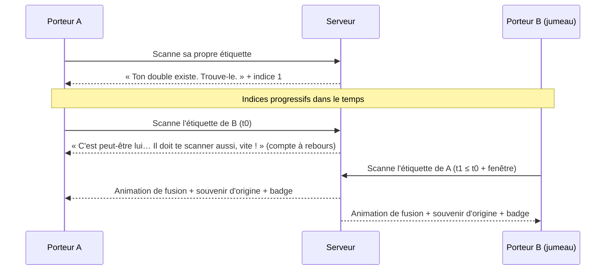

# FEAT-007 : Jumeaux, triplés et retrouvailles

[← Fonctionnalités](README.md)

**Statut :** Confirmé · **Sources :** S1, S3

## Objectif
Certaines étiquettes sont liées **en configuration** à une ou deux autres (jumeaux ou triplés), qui ont chacune leur **propre identifiant** (S1, voir [DEC-002](../decisions.md#dec-002)). Les porteurs doivent **se retrouver dans la foule** et **se rencontrer** (S3). C'est le moment fort de la soirée et un excellent moteur de conversation.

## Parcours nominal

*Figure : retrouvailles par scan mutuel. Statut : Confirmé (règle S3) ; textes : Proposition.*

## Règles métier
| ID | Règle | Statut |
|----|-------|--------|
| RG-007-1 | Un groupe compte 2 étiquettes (jumeaux) ou 3 (triplés), avec des identifiants distincts. | Confirmé (S1, S3) |
| RG-007-2 | Il y a « quelques » triplés. | Confirmé (S3) ; nombre : [Q-018](../questions-ouvertes.md#q-018) |
| RG-007-3 | Le joueur apprend qu'il a un double en scannant **sa propre étiquette** ou, s'il est retenu, dans un écran après la création. | Confirmé (S1) ; second canal : Proposition |
| RG-007-4 | **Indices progressifs** : ils sont tirés des attributs de costume du jumeau ([FEAT-003](personnage.md)) et révélés au fil du temps. | Confirmé (S3 : « génial ») |
| RG-007-5 | Ordre des indices : couleur, puis catégorie, puis booléens, puis emoji, puis pseudo. Heures ou délais : [Q-018](../questions-ouvertes.md#q-018). | Proposition |
| RG-007-6 | Un indice n'est révélé que lorsque le jumeau a créé son personnage. Avant, on affiche « Ton double n'est pas encore né. » | Proposition |
| RG-007-7 | Les **retrouvailles** exigent un **scan mutuel** : A scanne B et B scanne A dans une **fenêtre courte**, par exemple 1 minute. | Confirmé (S3) ; valeur de 60 s : Hypothèse ([Q-018](../questions-ouvertes.md#q-018)) |
| RG-007-8 | Hors de la fenêtre, le premier scan compte comme un scan normal ; la fenêtre redémarre au prochain scan entre les deux. | Proposition |
| RG-007-9 | Les deux joueurs voient l'animation de retrouvailles **au même moment**, au second scan, pour qu'aucun des deux ne soit favorisé. | Confirmé (S3 : éviter une animation biaisée pour le premier) |
| RG-007-10 | Les retrouvailles donnent un **badge « Jumeaux retrouvés »**. | Confirmé (S3) |
| RG-007-11 | Pour des triplés, les retrouvailles complètes exigent les 3 paires mutuelles. Les retrouvailles partielles (2 sur 3) donnent un badge intermédiaire. | Proposition |
| RG-007-12 | Le premier groupe réuni de la soirée obtient un titre au classement ([FEAT-015](badges-classements.md)). | Proposition (S2) |

## Variantes
| Cas | Comportement |
|-----|--------------|
| Le jumeau ne se présente jamais | Les indices continuent jusqu'au pseudo ; à la fin, « Ton double a fui la Matrice. » (Proposition) |
| Une étiquette jumelle est « tuée dans l'œuf » | Selon [Q-005](../questions-ouvertes.md#q-005) |
| B a été scanné par A avant que A sache qu'il est son jumeau | Aucun effet rétroactif ; les retrouvailles exigent tout de même le scan mutuel. (Proposition) |

## Interface
Après le premier scan de la paire : compte à rebours bien visible, avec le message « Fais-toi scanner par ton double ! ». Les deux joueurs voient l'animation de fusion des deux cartes.

## Critères d'acceptation
- **CA-007-1 :** Étant donné A et B jumeaux, quand A scanne B puis B scanne A en 40 s, alors les deux reçoivent le badge et l'animation à l'instant du second scan.
- **CA-007-2 :** Étant donné que A scanne B, quand B scanne A au bout de 3 min, alors il n'y a pas de retrouvailles ; un nouvel essai reste possible.
- **CA-007-3 :** Étant donné un groupe configuré, aucun indice ne révèle d'information sur un jumeau qui n'a pas encore de personnage.
- **CA-007-4 :** Étant donné une étiquette quelconque, ni son code ni son QR ne permettent de savoir si elle est jumelle ([RG-001-8](etiquettes-impression.md)).
