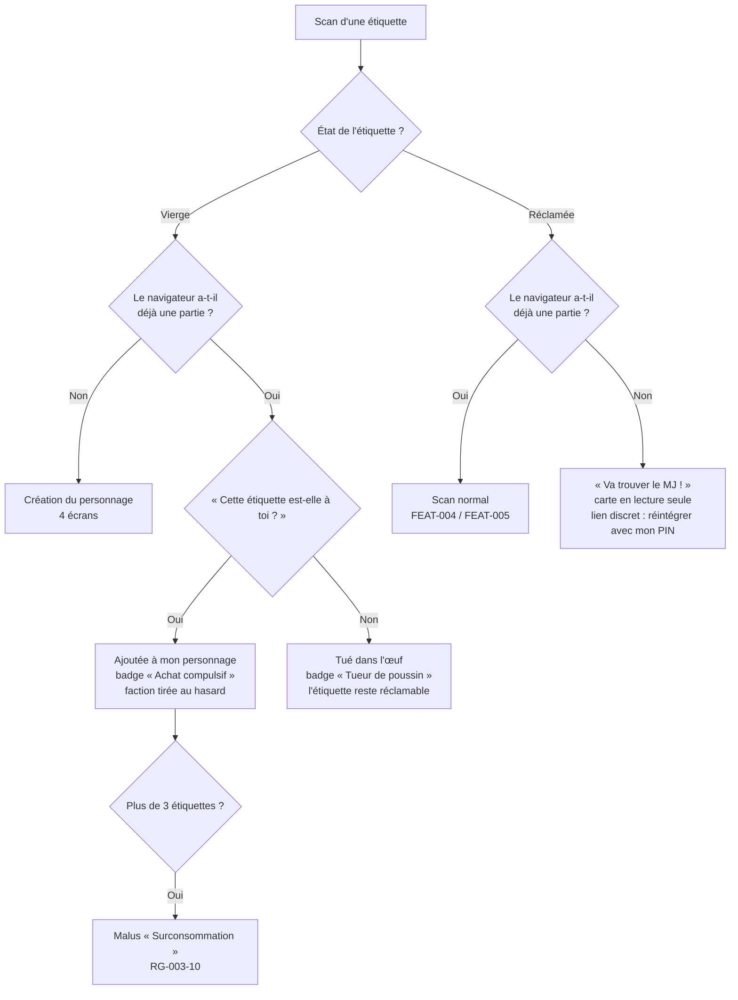

# FEAT-003 : Création du personnage au premier scan et « Tué dans l'œuf »

[← Fonctionnalités](README.md)

**Statut :** Confirmé · **Sources :** S1 (« génial !!! »), S3, S5, S6, S7, S8

## Objectif
Le premier scan d'une étiquette vierge permet de la **réclamer** en créant son **personnage**. Florian n'a rien à préparer par personne (S1). La création doit être **rapide, sans clavier et très simple à comprendre**, faute de quoi les joueurs décrochent (S3, S8). Cible : **moins de 30 s**, en **4 écrans** ([DEC-073](../decisions.md#dec-073)).

## Utilisateurs
Porteur (création), joueur actif (ajout d'une étiquette ou « Tué dans l'œuf »), spectateur (scan sans personnage).

## Préconditions et déclencheur
Scan d'une étiquette **vierge**. Une étiquette devient jouable **dès qu'on la scanne** : il n'y a pas d'activation par le MJ ([DEC-063](../decisions.md#dec-063)).

## Arbre de décision

*Figure : arbre de décision au scan. Statut : Confirmé (S5 à S8).*

## Parcours nominal : création en 4 écrans (Confirmé, S8)
Un bouton **Retour** permet de revenir à l'écran précédent à tout moment de la création (S7).

| Écran | Contenu | Ce que le joueur fait |
|-------|---------|----------------------|
| **1. Avertissement** | Jeu **punk et anticapitaliste** ; données **intégralement supprimées 7 jours après la fête** ; aucun usage commercial ; installation **fortement recommandée**, mais jeu jouable en scannant seulement les QR ([DEC-040](../decisions.md#dec-040)) | Touche « J'ai compris » |
| **2. Ton costume** | Grille des **8 emoji de type de costume** : « Choisis ce qui te ressemble le plus ». **L'emoji du personnage est l'emoji de son type** : il n'y a pas d'autre emoji à choisir (S8) | Touche un emoji |
| **3. Les détails** | Sur le même écran : la **couleur dominante** (12 pastilles) et les **12 attributs** à cocher, avec la consigne « Coche tout ce qu'on peut voir de loin » | Touche une couleur et coche des attributs |
| **4. Ta carte** | Récapitulatif : **pseudo généré au hasard**, avec la mention visible « Tu pourras le changer depuis ta fiche » ; **faction** et **classe D&D** tirées au hasard ; case « J'accepte que mes photos de scan apparaissent à la révélation » ; saisie du **PIN à 4 chiffres** ; bouton **« Créer mon personnage »** | Saisit son PIN et valide |

Ensuite, un **tutoriel d'un seul écran** puis l'écran d'accueil ([interface §2bis](../interface.md#2bis-accueil-et-tutoriel)).

## Ce qui est tiré au hasard ou choisi (Confirmé, S8, [DEC-074](../decisions.md#dec-074))
| Élément | Mode | Modifiable ensuite ? |
|---------|------|----------------------|
| Type de costume (emoji) | Choisi | Oui, selon RG-003-11 |
| Couleur dominante | Choisie | Oui, selon RG-003-11 |
| Attributs | Choisis | Oui, selon RG-003-11 |
| Pseudo | **Tiré au hasard** (à partir du type, de la couleur et d'un prix soldé) | Oui, jusqu'à minuit |
| Faction | **Tirée au hasard**, en favorisant la faction la moins remplie | **Non**, jamais |
| Classe D&D | **Tirée au hasard** | Oui, jusqu'à **1 h** ; un personnage créé après 1 h peut la changer jusqu'à son premier scan par un autre joueur. Le personnage reçoit alors le badge **« Trans-classe »** |
| Autorisation photo | Choisie | Oui, à tout moment : c'est un consentement, il reste révocable ([REQ-010](../exigences-transversales.md#req-010)) |
| PIN | Choisi | Réinitialisable par le MJ |

## Listes
Libellés définitifs en français et en anglais : [textes §1](../textes.md#1-libellés-de-la-création-du-personnage).

### Types de costume (8)
| Emoji | Type | Exemples |
|-------|------|----------|
| 🧟 | Mort-vivant | zombie, squelette, momie, fantôme |
| 🧛 | Vampire et créature de la nuit | vampire, loup-garou, démon |
| 🧙 | Magie et fantasy | sorcier·ère, elfe, fée, personnage D&D |
| 🤖 | Robot et sci-fi | robot, cyborg, alien, astronaute |
| 🦄 | Animal et créature | licorne, chat, dinosaure, insecte |
| 💋 | Sexy et uniforme | infirmière sexy, policier, pompier, soubrette |
| 🦸 | Pop culture | super-héros, personnage de film, de jeu ou de série |
| 🤡 | Inclassable | objet, concept, jeu de mots, déguisement absurde |

### Couleurs dominantes (12)
Noir, blanc, argent, rouge, orange, doré, vert, bleu, violet, rose, brun, arc-en-ciel.

### Attributs (24)
Masque ; maquillage sur le visage ; perruque ou cheveux colorés ; cornes ou oreilles ; ailes ; chapeau ou couvre-chef ; lumières ou électronique ; faux sang ; accessoire tenu à la main ou à la ceinture ; cape ou manteau long ; paillettes ou tissu brillant ; queue.

Derrière **« Charger plus »** (Proposition) : lunettes ou lentilles ; couronne ou tiare ; crocs ou fausses dents ; armure ou casque ; arme factice ; plumes ou fourrure ; cuir, latex ou vinyle ; chaînes ou gros bijoux ; tatouages ou peinture sur le corps ; tentacules ou membres en trop ; combinaison intégrale ou mascotte ; pancarte ou texte écrit. Libellés exacts : [textes §1.3](../textes.md#13-attributs-24).

## Parcours : un joueur actif scanne une étiquette vierge
Un même personnage peut posséder **plusieurs étiquettes** ([DEC-020](../decisions.md#dec-020)) :
1. L'app demande : **« Cette étiquette est-elle à toi ? »**
2. **Oui** : l'étiquette est ajoutée au personnage, avec une faction **tirée au hasard** parmi celles qu'il n'a pas encore ; il gagne le badge **« Achat compulsif »** ([DEC-062](../decisions.md#dec-062)).
3. **Non** : c'est un « Tué dans l'œuf ». Le scanneur gagne le badge **« Tueur de poussin »** ; l'étiquette **reste réclamable** ([DEC-023](../decisions.md#dec-023)).

Le joueur peut mentir et s'approprier l'étiquette de quelqu'un d'autre. Ce risque est accepté ; le MJ peut détacher une étiquette depuis l'admin.

## Variantes et cas limites
| Cas | Comportement | Statut |
|-----|--------------|--------|
| Florian donne des étiquettes à un groupe | Chacun scanne la sienne tout de suite, puis le groupe se scanne entre soi : premier faux souvenir immédiat ([pitch](../textes.md#4-pitch-de-distribution)) | Confirmé (S8) |
| Abandon en cours de création | L'étiquette reste vierge ; le brouillon est conservé localement. | Proposition |
| Deux appareils réclament la même étiquette simultanément | Le premier enregistré côté serveur l'emporte ; le second reçoit « déjà réclamée ». | Proposition |
| Personnage créé après minuit | Le joueur choisit tout à la création ; son costume reste modifiable jusqu'à ce qu'un autre joueur le scanne pour la première fois | Confirmé (S8) |
| Étiquettes portées par Florian | Son étiquette personnelle, des légendaires et des pièges ([FEAT-022](costume-mj.md)) | Confirmé |
| Personne sans étiquette | Spectateur limité ; invitée à aller trouver le MJ | Confirmé ([DEC-038](../decisions.md#dec-038), [DEC-054](../decisions.md#dec-054)) |

## Règles métier
| ID | Règle | Statut |
|----|-------|--------|
| RG-003-1 | La **première** personne qui scanne une étiquette vierge, sans avoir de personnage, la réclame. | Confirmé (S1, S3) |
| RG-003-2 | Un appareil ne possède **qu'un seul** personnage. | Hypothèse |
| RG-003-3 | Une étiquette réclamée appartient pour toute la soirée à un seul personnage. Un personnage peut avoir **plusieurs** étiquettes ; chacune a sa propre faction, dans la limite de 3 factions différentes. | Confirmé (S5, S7) |
| RG-003-4 | La création se fait **sans clavier obligatoire**, à l'exception du code PIN sur pavé numérique. | Confirmé (S3, S5) |
| RG-003-5 | Les attributs de costume nourrissent les indices des jumeaux ([FEAT-007](jumeaux.md)) et les faux souvenirs ([FEAT-006](faux-souvenirs.md)). Ils sont communs à toutes les étiquettes du personnage. | Confirmé (S3, S5) |
| RG-003-6 | Scanner une étiquette vierge avec une partie en cours **et** répondre qu'elle n'est pas à soi donne le badge « Tueur de poussin ». L'étiquette reste réclamable. | Confirmé (S3, S5, S7) |
| RG-003-7 | La création tient en 4 écrans et prend moins de 30 s pour un joueur moyen. | Confirmé (S5, S8) |
| RG-003-8 | Toutes les données du personnage sont enregistrées **dans le cloud** ; le stockage local ne sert que de cache ([DEC-052](../decisions.md#dec-052)). | Confirmé (S6) |
| RG-003-9 | Retour arrière possible pendant toute la création. | Confirmé (S7) |
| RG-003-10 | **Surconsommation** : chaque étiquette au-delà de la 3e reprend une faction existante et déclenche des malus lourds : badge « Surconsommation » ; scanner bloqué 10 min ; points de faction du joueur réduits de 50 % ; bonus multi-faction annulé ; contribution à la quête divisée par 2 ; corruption immédiate, **sans immunité possible** jusqu'à la fin de la soirée. Le message doit être clair : « Ne prends pas trop d'étiquettes. » | Confirmé (S7, [DEC-064](../decisions.md#dec-064)) |
| RG-003-11 | **Modification.** Tout ce qui est modifiable l'est **jusqu'à minuit** au plus tard. Ce qui pèse sur la dynamique de jeu (type, couleur, attributs, qui servent aux indices des jumeaux et aux souvenirs) se fige en plus dès qu'**un autre joueur scanne ce personnage pour la première fois**. Ce qui n'a pas d'effet sur le jeu (pseudo) reste modifiable jusqu'à minuit. Un personnage créé après minuit garde son costume modifiable jusqu'à son premier scan par un autre joueur. | Confirmé (S8, [DEC-075](../decisions.md#dec-075)) ; « premier scan par un autre joueur » : Hypothèse |
| RG-003-12 | La classe est modifiable jusqu'à **1 h** du matin, ou, pour un personnage créé après 1 h, jusqu'à son premier scan par un autre joueur. La changer donne le badge **« Trans-classe »**. | Confirmé (S8, [DEC-078](../decisions.md#dec-078)) |
| RG-003-13 | Quand le pseudo est affiché au joueur pour la première fois, l'écran indique qu'il pourra le changer depuis sa fiche. | Confirmé (S8) |

## Données
**Crée :** `Personnage`, `Appareil` (jeton) · **Modifie :** `Etiquette.etat`, `Etiquette.faction_id` ([données](../donnees.md)).

## Permissions
Seul l'appareil propriétaire modifie le personnage. Ses attributs sont visibles par ceux qui le scannent. Le pseudo et l'emoji apparaissent dans les classements publics.

## Critères d'acceptation
- **CA-003-1 :** Étant donné une étiquette vierge et un appareil sans personnage, quand l'utilisateur passe les 4 écrans en touchant seulement des choix prédéfinis et en saisissant son PIN, alors un personnage est créé et l'étiquette passe à « réclamée ».
- **CA-003-2 :** Étant donné un appareil qui a un personnage, quand il scanne une étiquette vierge et répond « Non », alors il reçoit « Tueur de poussin » et l'étiquette reste vierge.
- **CA-003-3 :** Étant donné deux réclamations simultanées, alors une seule réussit.
- **CA-003-4 :** Le pseudo proposé n'est jamais vide, respecte [univers-et-ton](../univers-et-ton.md), et l'écran 4 indique qu'il est modifiable.
- **CA-003-5 :** Étant donné un appareil qui a un personnage, quand il scanne une étiquette vierge et répond « Oui », alors l'étiquette est liée à son personnage et il reçoit « Achat compulsif ».
- **CA-003-6 :** L'écran d'avertissement s'affiche avant toute création.
- **CA-003-7 :** Depuis n'importe quel écran de création, « Retour » ramène à l'écran précédent sans perdre les choix déjà faits.
- **CA-003-8 :** Étant donné un personnage à 3 étiquettes, quand il en ajoute une 4e, alors tous les malus de RG-003-10 s'appliquent.
- **CA-003-9 :** Étant donné un personnage déjà scanné par un autre joueur, alors son type, sa couleur et ses attributs ne sont plus modifiables, même avant minuit.
- **CA-003-10 :** La faction n'est jamais modifiable ; la classe l'est jusqu'à 1 h (ou jusqu'au premier scan par un autre joueur pour un personnage créé après 1 h), et la modifier attribue « Trans-classe ».
