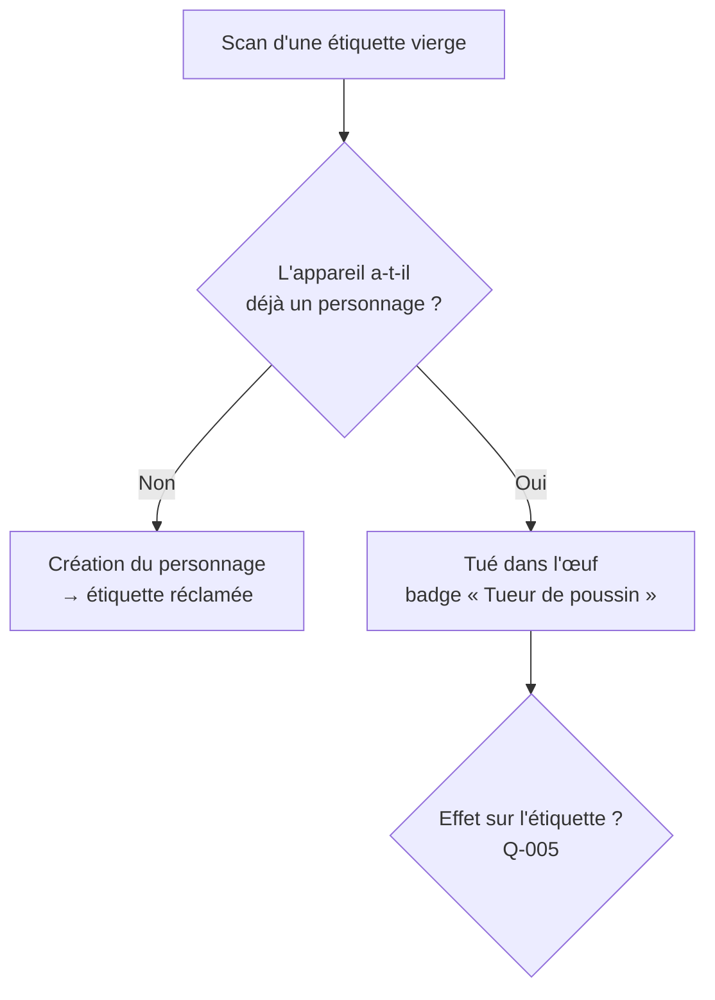

# FEAT-003 : Création du personnage au premier scan et « Tué dans l'œuf »

[← Fonctionnalités](README.md)

**Statut :** Confirmé · **Sources :** S1 (« génial !!! »), S3

## Objectif
Le premier scan d'une étiquette vierge permet de la **réclamer** en créant son **personnage**. Florian n'a rien à préparer par personne (S1). La création doit être **rapide et sans clavier**, faute de quoi les joueurs décrochent (S3).

## Utilisateurs
Porteur (création), joueur actif (« Tué dans l'œuf »).

## Préconditions et déclencheur
Scan d'une étiquette **vierge** ([glossaire](../glossaire.md)).

## Arbre de décision

## Parcours nominal : création
1. Écran « Une nouvelle pièce vient d'arriver en magasin. C'est toi. » (Proposition de ton.)
2. **Description du costume, sans clavier** (Confirmé, S3) :
   - **catégorie de costume**, dans une grille de pictos (liste : [Q-004](../questions-ouvertes.md#q-004)) ;
   - **couleur dominante**, dans une palette de pastilles ;
   - **booléens** : masque, maquillage, accessoires. D'autres sont possibles : perruque, cornes, ailes, lumière… (liste finale : [Q-004](../questions-ouvertes.md#q-004)).
3. **Emoji** choisi dans une courte sélection Halloween (Confirmé pour l'emoji, S1).
4. **Pseudo** : généré automatiquement à partir des choix, avec un bouton « relancer le dé » ; la saisie libre reste possible. C'est une **Proposition**, qui répond à « pas de clavier ». Exemple : *« Sorcière Vert Kaki −40 % »*.
5. Éléments de jeu attribués : faction ([FEAT-011](factions.md)) et éventuellement une classe D&D. **À préciser** ([Q-014](../questions-ouvertes.md#q-014), [Q-015](../questions-ouvertes.md#q-015)).
6. Confirmation : l'étiquette est réclamée, la fiche du personnage s'affiche, puis le tutoriel en un écran.

## Parcours : « Tué dans l'œuf »
1. Un joueur actif scanne une étiquette vierge.
2. Il obtient le badge **« Tueur de poussin »** (Confirmé, S3).
3. L'effet sur l'étiquette reste **À préciser** ([Q-005](../questions-ouvertes.md#q-005)). Options :
   - (a) l'étiquette est définitivement morte ;
   - (b) elle reste réclamable, seul le badge est donné ;
   - (c) elle devient une carte spéciale « œuf brisé », et son futur porteur naît avec un malus ou un bonus humoristique.

## Variantes et cas limites
| Cas | Comportement | Statut |
|-----|--------------|--------|
| Quelqu'un réclame l'étiquette avant la personne à qui Florian l'a donnée | Risque connu. **Rituel de remise** : Florian demande qu'on scanne immédiatement. | Proposition (S2) |
| Abandon en cours de création | L'étiquette reste vierge ; le brouillon est conservé localement. | Proposition |
| Deux appareils réclament la même étiquette simultanément | Le premier enregistré côté serveur l'emporte ; le second reçoit le résultat « Tué dans l'œuf » ou « déjà réclamée ». | Proposition |
| Le joueur veut modifier son costume après coup | Possible ? | À préciser ([Q-011](../questions-ouvertes.md#q-011)) |
| Étiquettes portées par Florian | Personnage unique « Florian », ou étiquettes vierges distribuables ? | À préciser ([Q-010](../questions-ouvertes.md#q-010)) |
| Personne sans étiquette | Spectateur ? | À préciser ([Q-003](../questions-ouvertes.md#q-003)) |

## Règles métier
| ID | Règle | Statut |
|----|-------|--------|
| RG-003-1 | La **première** personne qui scanne une étiquette vierge, sans avoir de personnage, la réclame. | Confirmé (S1, S3) |
| RG-003-2 | Un appareil ne possède **qu'un seul** personnage. | Hypothèse, nécessaire à « Tué dans l'œuf » |
| RG-003-3 | Une étiquette réclamée appartient pour toute la soirée à un seul personnage. | Hypothèse |
| RG-003-4 | La création se fait **sans clavier obligatoire**. | Confirmé (S3) |
| RG-003-5 | Les attributs de costume nourrissent les indices des jumeaux ([FEAT-007](jumeaux.md)) et les faux souvenirs ([FEAT-006](faux-souvenirs.md)). | Confirmé (S3) |
| RG-003-6 | Scanner une étiquette vierge avec un personnage existant donne le badge « Tueur de poussin ». | Confirmé (S3) |
| RG-003-7 | La création prend au plus N secondes pour un joueur moyen. | À préciser ([Q-004](../questions-ouvertes.md#q-004)) |

## Données
**Crée :** `Personnage`, `Appareil` (jeton) · **Modifie :** `Etiquette.etat` ([données](../donnees.md)).

## Permissions
Seul l'appareil propriétaire modifie le personnage. Ses attributs sont visibles par ceux qui le scannent. Le pseudo et l'emoji apparaissent dans les classements publics.

## Critères d'acceptation
- **CA-003-1 :** Étant donné une étiquette vierge et un appareil sans personnage, quand l'utilisateur termine le parcours en touchant seulement des choix prédéfinis, alors un personnage est créé et l'étiquette passe à « réclamée ».
- **CA-003-2 :** Étant donné un appareil qui a un personnage, quand il scanne une étiquette vierge, alors il reçoit « Tueur de poussin », et l'étiquette suit la règle retenue en [Q-005](../questions-ouvertes.md#q-005).
- **CA-003-3 :** Étant donné deux réclamations simultanées, alors une seule réussit.
- **CA-003-4 :** Le pseudo proposé n'est jamais vide et respecte [univers-et-ton](../univers-et-ton.md).
