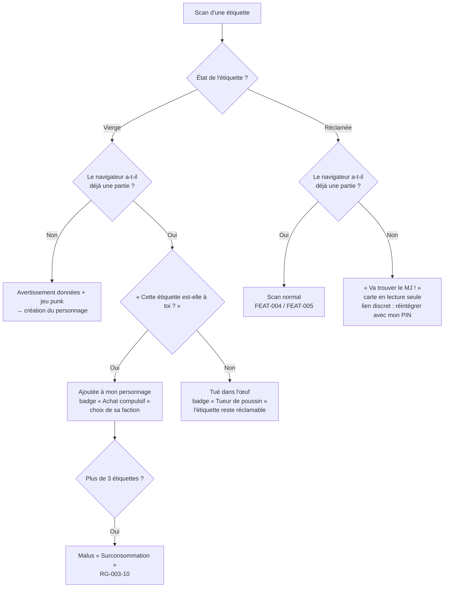

# FEAT-003 : Création du personnage au premier scan et « Tué dans l'œuf »

[← Fonctionnalités](README.md)

**Statut :** Confirmé · **Sources :** S1 (« génial !!! »), S3, S5, S6, S7

## Objectif
Le premier scan d'une étiquette vierge permet de la **réclamer** en créant son **personnage**. Florian n'a rien à préparer par personne (S1). La création doit être **rapide et sans clavier**, faute de quoi les joueurs décrochent (S3). Cible : **moins de 30 s** ([DEC-026](../decisions.md#dec-026)).

## Utilisateurs
Porteur (création), joueur actif (ajout d'une étiquette ou « Tué dans l'œuf »), spectateur (scan sans personnage).

## Préconditions et déclencheur
Scan d'une étiquette **vierge**. Une étiquette devient jouable **dès qu'on la scanne** : il n'y a pas d'activation par le MJ. Les étiquettes que Florian garde dans sa banane sont simplement hors d'atteinte ([DEC-063](../decisions.md#dec-063)).

## Arbre de décision

*Figure : arbre de décision au scan. Statut : Confirmé (S5, S6, S7).*

## Parcours nominal : création
La création se fait sur des **écrans successifs**, une information par écran. Un bouton **Retour** permet de revenir à l'écran précédent à tout moment de la création, y compris depuis l'écran du premier scan (Confirmé, S7).

1. **Avertissement** (Confirmé, S5, [DEC-040](../decisions.md#dec-040)) : c'est un jeu **punk et anticapitaliste** ; toutes les données sont **supprimées 7 jours après la fête** ([DEC-035](../decisions.md#dec-035)) ; aucune donnée ne sert à un but commercial ; il est **fortement recommandé d'installer l'app**, mais le jeu reste jouable en scannant seulement les QR codes.
2. **Type de costume** : une grille de **8 emoji** ; consigne « Choisis ce qui te ressemble le plus » (Confirmé, S6).
3. **Couleur dominante** du costume : **12 pastilles** (Confirmé, S7, [DEC-059](../decisions.md#dec-059)). Elle n'a aucun lien avec la faction.
4. **12 attributs** en icônes à cocher, avec une consigne en haut de l'écran (Confirmé, S5, S6).
5. **Faction** de l'étiquette : 5 factions, une faction trop pleine est masquée ([FEAT-011](factions.md)).
6. **Classe D&D** (Confirmé, S5, [DEC-030](../decisions.md#dec-030)) ; liste à définir avec les duels.
7. **Emoji** de profil choisi dans une courte sélection Halloween (Confirmé, S1).
8. **Pseudo** : généré automatiquement à partir des choix, avec un bouton « relancer le dé » ; la saisie libre reste possible. C'est une **Proposition**, qui répond à « pas de clavier ». Exemple : *« Vampire Bordeaux à cornes −40 % »*.
9. **Photos** : autorisation (oui ou non) d'utiliser à la révélation les photos prises pendant ses scans. L'écran explique qu'il vaut mieux cadrer l'étiquette **sans qu'on reconnaisse la personne**, et que les photos sont supprimées avec le reste des données ([FEAT-017](mur-deja-vu.md), [DEC-061](../decisions.md#dec-061)).
10. **Code PIN à 4 chiffres** choisi par le joueur, pour réintégrer le jeu depuis un autre navigateur ([FEAT-019](recuperation.md)). C'est la seule saisie, sur pavé numérique.
11. Confirmation : l'étiquette est réclamée, la fiche du personnage s'affiche, puis le tutoriel en un écran et l'invitation à installer l'app.

Jusqu'à **minuit**, le joueur peut modifier son personnage depuis sa fiche ; ensuite, la description est figée pour les indices des jumeaux ([DEC-041](../decisions.md#dec-041)).

## Listes
Libellés définitifs en français et en anglais : [textes §1](../textes.md#1-libellés-de-la-création-du-personnage).

### Types de costume (8, Confirmé pour le nombre, S6 ; libellés : Proposition)
| Emoji | Type | Exemples |
|-------|------|----------|
| 🧟 | Mort-vivant | zombie, squelette, momie, fantôme |
| 🧛 | Vampire et créature de la nuit | vampire, loup-garou, démon |
| 🧙 | Magie et fantasy | sorcier·ère, elfe, fée, personnage D&D |
| 🤖 | Robot et sci-fi | robot, cyborg, alien, astronaute |
| 🦄 | Animal et créature | licorne, chat, dinosaure, insecte |
| 💋 | Sexy et uniforme | infirmière sexy, policier, pompier, soubrette |
| 🦸 | Pop culture | super-héros, personnage de film, de jeu ou de série |
| 🤡 | Inclassable | objet, concept, jeu de mots, déguisement absurde |

### Couleurs dominantes (12, Confirmé pour le nombre, S7 ; liste : Proposition)
Noir, blanc, gris ou argent, rouge, orange, jaune ou doré, vert, bleu, violet, rose, marron ou beige, multicolore.

### Attributs (12, Confirmé pour le nombre, S5 ; liste : Proposition)
Ils doivent être **visibles de loin**, puisqu'ils servent d'indices.
| # | Attribut | # | Attribut |
|---|----------|---|----------|
| 1 | Masque | 7 | Lumières ou électronique |
| 2 | Maquillage sur le visage | 8 | Faux sang |
| 3 | Perruque ou cheveux colorés | 9 | Accessoire tenu à la main ou à la ceinture (arme, baguette, sac…) |
| 4 | Cornes ou oreilles | 10 | Cape ou manteau long |
| 5 | Ailes | 11 | Paillettes ou tissu brillant |
| 6 | Chapeau ou couvre-chef | 12 | Queue |

## Parcours : un joueur actif scanne une étiquette vierge
Un même personnage peut posséder **plusieurs étiquettes** ([DEC-020](../decisions.md#dec-020)). Règle (Confirmé, S7, [DEC-062](../decisions.md#dec-062)) :
1. L'app demande : **« Cette étiquette est-elle à toi ? »**
2. **Oui** : l'étiquette est ajoutée au personnage ; le joueur choisit sa faction ; il gagne le badge **« Achat compulsif »**.
3. **Non** : c'est un « Tué dans l'œuf ». Le scanneur gagne le badge **« Tueur de poussin »** ; l'étiquette **reste réclamable** ([DEC-023](../decisions.md#dec-023)).

Le joueur peut mentir et s'approprier l'étiquette de quelqu'un d'autre. Ce risque est accepté ; le MJ peut détacher une étiquette depuis l'admin.

## Variantes et cas limites
| Cas | Comportement | Statut |
|-----|--------------|--------|
| Quelqu'un réclame l'étiquette avant la personne à qui Florian l'a donnée | **Rituel de remise** : Florian demande qu'on scanne immédiatement. | Proposition |
| Abandon en cours de création | L'étiquette reste vierge ; le brouillon est conservé localement. | Proposition |
| Deux appareils réclament la même étiquette simultanément | Le premier enregistré côté serveur l'emporte ; le second reçoit « déjà réclamée ». | Proposition |
| Le joueur veut modifier son costume après coup | Possible jusqu'à minuit, figé ensuite | Confirmé ([DEC-041](../decisions.md#dec-041)) |
| Étiquettes portées par Florian | Son étiquette personnelle, des légendaires et des pièges ([FEAT-022](costume-mj.md)) | Confirmé ([DEC-024](../decisions.md#dec-024)) |
| Personne sans étiquette | Spectateur limité ; invitée à aller trouver le MJ | Confirmé ([DEC-038](../decisions.md#dec-038), [DEC-054](../decisions.md#dec-054)) |

## Règles métier
| ID | Règle | Statut |
|----|-------|--------|
| RG-003-1 | La **première** personne qui scanne une étiquette vierge, sans avoir de personnage, la réclame. | Confirmé (S1, S3) |
| RG-003-2 | Un appareil ne possède **qu'un seul** personnage. | Hypothèse |
| RG-003-3 | Une étiquette réclamée appartient pour toute la soirée à un seul personnage. Un personnage peut avoir **plusieurs** étiquettes ; chacune a sa propre faction, dans la limite de 3 factions différentes. | Confirmé (S5, S7) |
| RG-003-4 | La création se fait **sans clavier obligatoire**, à l'exception du code PIN sur pavé numérique. | Confirmé (S3, S5) |
| RG-003-5 | Les attributs de costume nourrissent les indices des jumeaux ([FEAT-007](jumeaux.md)) et les faux souvenirs ([FEAT-006](faux-souvenirs.md)). Ils sont communs à toutes les étiquettes du personnage. | Confirmé (S3, S5) |
| RG-003-6 | Scanner une étiquette vierge avec une partie en cours **et** répondre qu'elle n'est pas à soi donne le badge « Tueur de poussin ». L'étiquette reste réclamable. | Confirmé (S3, S5, S7) |
| RG-003-7 | La création prend moins de 30 s pour un joueur moyen. | Confirmé (S5) |
| RG-003-8 | Toutes les données du personnage sont enregistrées **dans le cloud** ; le stockage local ne sert que de cache ([DEC-052](../decisions.md#dec-052)). | Confirmé (S6) |
| RG-003-9 | Une information par écran ; retour arrière possible pendant toute la création. | Confirmé (S7) |
| RG-003-10 | **Surconsommation** : chaque étiquette au-delà de la 3e reprend une faction existante et déclenche des malus lourds : badge « Surconsommation » ; scanner bloqué 10 min ; points de faction du joueur réduits de 50 % ; bonus multi-faction annulé ; contribution à la quête divisée par 2 ; corruption immédiate, **sans immunité possible** jusqu'à la fin de la soirée. Le message doit être clair : « Ne prends pas trop d'étiquettes. » | Confirmé (S7, [DEC-064](../decisions.md#dec-064)) ; valeurs : Proposition |

## Données
**Crée :** `Personnage`, `Appareil` (jeton) · **Modifie :** `Etiquette.etat`, `Etiquette.faction_id` ([données](../donnees.md)).

## Permissions
Seul l'appareil propriétaire modifie le personnage. Ses attributs sont visibles par ceux qui le scannent. Le pseudo et l'emoji apparaissent dans les classements publics.

## Critères d'acceptation
- **CA-003-1 :** Étant donné une étiquette vierge et un appareil sans personnage, quand l'utilisateur termine le parcours en touchant seulement des choix prédéfinis et en saisissant son PIN, alors un personnage est créé et l'étiquette passe à « réclamée ».
- **CA-003-2 :** Étant donné un appareil qui a un personnage, quand il scanne une étiquette vierge et répond « Non », alors il reçoit « Tueur de poussin » et l'étiquette reste vierge.
- **CA-003-3 :** Étant donné deux réclamations simultanées, alors une seule réussit.
- **CA-003-4 :** Le pseudo proposé n'est jamais vide et respecte [univers-et-ton](../univers-et-ton.md).
- **CA-003-5 :** Étant donné un appareil qui a un personnage, quand il scanne une étiquette vierge et répond « Oui », alors l'étiquette est liée à son personnage et il reçoit « Achat compulsif ».
- **CA-003-6 :** L'écran d'avertissement (jeu punk, suppression des données, pas d'usage commercial, installation recommandée) s'affiche avant toute création.
- **CA-003-7 :** Depuis n'importe quel écran de création, « Retour » ramène à l'écran précédent sans perdre les choix déjà faits.
- **CA-003-8 :** Étant donné un personnage à 3 étiquettes, quand il en ajoute une 4e, alors tous les malus de RG-003-10 s'appliquent.
