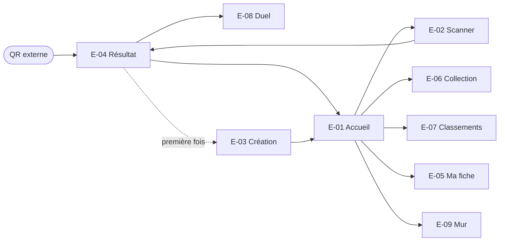

# Interface

[← Index](../README.md)

## 1. Principes

| ID | Principe | Statut | Source |
|----|----------|--------|--------|
| UI-1 | **Mobile d'abord**, utilisable d'une main, dans une salle **sombre** | Hypothèse (contexte) | S1 |
| UI-2 | **Pas de clavier** dans les parcours principaux | Confirmé | S3 |
| UI-3 | Tout est **rapide** : un toucher par action quand c'est possible | Confirmé (réactions, création) | S3 |
| UI-4 | Le thème « Déjà vu » se voit : échos, répétitions, boucles, glitchs | Confirmé (thème) ; traitement graphique : Proposition | S1, S3 |
| UI-5 | Esthétique d'**étiquette de vêtement et de soldes**, avec des touches D&D | Confirmé (univers) ; direction artistique : Proposition | S3 |
| UI-6 | Thème sombre par défaut, contraste élevé | Proposition ([REQ-002](exigences-transversales.md#req-002)) | — |

## 2. Inventaire des écrans

| ID | Écran | Fonctionnalités | Statut |
|----|-------|-----------------|--------|
| E-01 | Accueil du jeu : progression globale, bouton Scanner, mission active | [FEAT-009](fonctionnalites/quete-collective.md), [FEAT-013](fonctionnalites/missions-eclair.md) | Proposition |
| E-02 | Scanner : caméra, lampe, saisie de code | [FEAT-002](fonctionnalites/scan.md) | Confirmé |
| E-03 | Création du personnage, en 3 ou 4 étapes à pictos | [FEAT-003](fonctionnalites/personnage.md) | Confirmé |
| E-04 | Résultat de scan : nouvelle carte, Déjà vu, chat noir, Tué dans l'œuf, retrouvailles | FEAT-003 à 008, 010, 014 | Confirmé |
| E-05 | Ma fiche et mon double : indices du jumeau | [FEAT-007](fonctionnalites/jumeaux.md) | Confirmé |
| E-06 | Collection : grille, séries | [FEAT-004](fonctionnalites/collection.md), [FEAT-012](fonctionnalites/series-rarete.md) | Confirmé |
| E-07 | Classements | [FEAT-015](fonctionnalites/badges-classements.md) | Confirmé |
| E-08 | Duel | [FEAT-010](fonctionnalites/duel.md) | Confirmé (sous consentement) |
| E-09 | Mur « Déjà vu ! » | [FEAT-017](fonctionnalites/mur-deja-vu.md) | Confirmé |
| E-10 | Révélation finale | [FEAT-009](fonctionnalites/quete-collective.md) | Confirmé |
| E-11 | Lendemain et carte souvenir | [FEAT-018](fonctionnalites/lendemain-partage.md) | Confirmé |
| E-12 | Panneau MJ | [FEAT-020](fonctionnalites/admin.md) | Confirmé |
| E-13 | Vue projecteur | [FEAT-009](fonctionnalites/quete-collective.md) | Proposition |

## 3. Navigation


*Figure : navigation principale. Statut : Proposition. On suppose une barre d'onglets en bas (Accueil, Collection, **Scanner** au centre, Classements, Moi).*

## 4. États communs
| État | Comportement attendu (Proposition) |
|------|-------------------------------------|
| Chargement | Squelettes, plus un texte d'ambiance (« On cherche ta taille en réserve… ») ; jamais d'écran blanc |
| Vide | Texte humoristique et action suggérée (« Va scanner du monde ») |
| Hors ligne | Bandeau discret avec le nombre de scans en attente ([RG-021-6](fonctionnalites/pwa-hors-ligne.md)) |
| Erreur | Message dans le ton du jeu, plus une action de reprise (« Réessayer », « Saisir le code ») |
| Succès | Retour haptique (si disponible) et animation courte |

## 5. Maquettes filaires

> **Statut : propositions à valider.** Ce sont des maquettes textuelles indicatives, pas des références existantes.

**E-04 : Résultat d'une nouvelle carte**
```
┌──────────────────────────────┐
│ ▓▓▓▓▓▓▓░░░  Quête : 312/500  │  ← progression globale (RG-009-1)
├──────────────────────────────┤
│   NOUVELLE PIÈCE AJOUTÉE     │
│   ┌────────────────────┐     │
│   │ 🧛  Vampire Bordeaux│     │  ← carte (FEAT-004)
│   │     −40 % · RARE    │     │
│   │ Masque ✓ Maquill. ✓ │     │
│   └────────────────────┘     │
│ « Vous vous êtes rencontrés  │  ← faux souvenir (FEAT-006)
│  en 1997 dans un lave-auto…» │
│ ─ Toi vs Vampire ─────────── │  ← comparaison (FEAT-010)
│  23 cartes   |   41 cartes   │
│  Déjà vu les mêmes 4 : 👻🦇🎃🧙│
│ 🎃 👻 💀 🦇 🕷️ 🧛 🔮 🖤       │  ← réactions (FEAT-014)
│ [ ⚔️ Défier en duel ]        │  ← duel (FEAT-010)
└──────────────────────────────┘
```

**E-04 : Déjà vu**
```
┌──────────────────────────────┐
│      DÉJÀ VU ×3              │
│      DÉJÀ VU ×3              │  ← texte en écho
│      DÉJÀ VU ×3              │
│  🏅 Boucle détectée          │  ← RG-005-2
│  « Article déjà dans ton     │
│    panier. »                 │
└──────────────────────────────┘
```

**E-03 : Création du personnage, étape costume**
```
┌──────────────────────────────┐
│ Étape 2/4 · Ton costume      │
│ [🧛][🧟][🧙][👽][🤖][🦸][🐺][❓] │  ← catégories (Q-004)
│ ● ● ● ● ● ● ● ●              │  ← couleur
│ [Masque] [Maquillage] [Accessoires] │ ← bascules
│              [ Suivant → ]   │
└──────────────────────────────┘
```

## 6. Références visuelles

Des **illustrations générées** (statut : proposition) présentent le concept dans le [README](../README.md) ; leur fiche est dans [`assets/illustrations/`](../assets/illustrations/README.md). Florian n'a fourni **aucun visuel** réel. Aucune image externe n'a été intégrée : les photos des fiches Amazon sont protégées et ne doivent pas être réutilisées. Visuels à constituer, à déposer dans [`assets/references/`](../assets/references/README.md) :

| Visuel à ajouter | Type | Illustre | Statut attendu |
|------------------|------|----------|----------------|
| Photo d'une étiquette assemblée : autocollant QR sur l'étiquette manille, attachée au pistolet | Photo | [FEAT-001](fonctionnalites/etiquettes-impression.md), [CT-003](contraintes-techniques.md#ct-003) | Référence |
| Photo du costume complet de Florian | Photo | [Vision](vision.md) | Référence |
| Photo d'un test de scan en lumière faible | Photo | [CA-001-2](fonctionnalites/etiquettes-impression.md) | Référence |
| Capture du gabarit d'étiquette dans l'app Niimbot macOS | Capture | [CT-004](contraintes-techniques.md#ct-004) | Référence |
| Planche d'inspiration : vraies étiquettes de vêtements, consignes d'entretien, affiches de soldes | Photo | [Univers et ton](univers-et-ton.md) | Inspiration (droits à vérifier) |
| Maquettes haute fidélité des écrans E-01 à E-06 | Maquette | §2 | Proposition à valider |
