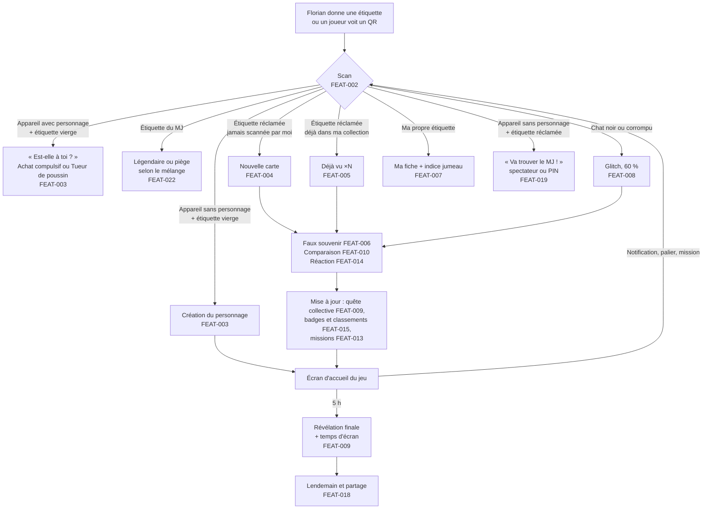

# Parcours utilisateur

[← Index](../README.md)

Ce document décrit **l'enchaînement** des fonctionnalités. Les règles détaillées se trouvent dans les fiches `FEAT-xxx`.

## 1. Vue d'ensemble : la soirée d'un joueur

*Figure 1 : parcours principal. Statut : Proposition de synthèse, construite à partir des fonctionnalités confirmées.*

## 2. Parcours détaillés

### P-1 : Recevoir une étiquette et créer son personnage
1. Florian remet une étiquette à quelqu'un. Il peut l'attacher au costume avec le pistolet à étiquettes ([CT-003](contraintes-techniques.md#ct-003)). C'est une Hypothèse.
2. La personne la scanne **tout de suite** : c'est le rituel de remise (Proposition, S2). L'étiquette devient jouable à ce scan.
3. L'app affiche l'avertissement (jeu punk et anticapitaliste, données supprimées, installation recommandée), puis lance la création du personnage, un écran par information, avec retour arrière possible ([FEAT-003](fonctionnalites/personnage.md)). Si la personne a déjà un personnage, l'app demande si l'étiquette est à elle.
4. Elle explique ensuite le jeu en un écran, propose d'installer l'app ([FEAT-021](fonctionnalites/pwa-hors-ligne.md)) puis d'activer le scanner intégré ([FEAT-002](fonctionnalites/scan.md)).

### P-2 : Collectionner quelqu'un
1. Le joueur A scanne l'étiquette du joueur B, depuis l'app ou depuis l'appareil photo.
2. La carte de B s'ajoute à la collection de A ([FEAT-004](fonctionnalites/collection.md)).
3. A voit le faux souvenir A×B ([FEAT-006](fonctionnalites/faux-souvenirs.md)) et la comparaison A vs B ([FEAT-010](fonctionnalites/duel.md)). Il peut laisser une réaction emoji ([FEAT-014](fonctionnalites/reactions.md)).
4. Si le scan est fait dans l'app, une photo basse qualité part sur le mur ([FEAT-017](fonctionnalites/mur-deja-vu.md)).
5. La quête collective, les badges et les missions sont mis à jour.

### P-3 : Retrouver son jumeau
Entre la 60e activation (ou minuit) et 2 h, le serveur forme les groupes. Les indices arrivent toutes les 10 min à partir de minuit. Voir le diagramme de séquence dans [FEAT-007](fonctionnalites/jumeaux.md).

### P-4 : Être contaminé par un chat noir
Voir le diagramme d'états dans [FEAT-008](fonctionnalites/chat-noir.md).

### P-5 : Fin de soirée
1. À 4 h 30, une annonce et un compte à rebours de 30 min préparent la révélation ([FEAT-016](fonctionnalites/notifications.md)).
2. À 5 h, tout le monde voit la constellation se transformer en dessin caché, les photos consenties, sa position dans le graphe et **son temps d'écran** de la soirée ([FEAT-009](fonctionnalites/quete-collective.md)).
3. Les classements finaux sont figés, avec les classements et badges par faction ; chaque joueur multi-factions est rattaché à sa faction la plus faible ([FEAT-015](fonctionnalites/badges-classements.md), [FEAT-011](fonctionnalites/factions.md)). Un compte à rebours annonce la fin du jeu à 6 h.

### P-5b : Changer de navigateur
Le joueur rescanne une de ses étiquettes depuis le nouveau navigateur. L'écran propose d'abord d'aller trouver le MJ ; en bas, il touche « Réintégrer le jeu avec mon PIN », saisit son code et retrouve tout son jeu depuis le cloud ([FEAT-019](fonctionnalites/recuperation.md)).

### P-6 : Le lendemain
Le joueur rouvre l'app. Il trouve un message du lendemain, sa carte souvenir et un bouton de partage ([FEAT-018](fonctionnalites/lendemain-partage.md)).

### P-7 : Maître du jeu
Avant la fête, Florian génère les étiquettes, configure les légendaires, les pièges, les séries et les paramètres des rôles dynamiques, puis imprime ([FEAT-001](fonctionnalites/etiquettes-impression.md)). Pendant la soirée, il distribue les étiquettes, suit la frise d'activité et déclenche des événements ([FEAT-020](fonctionnalites/admin.md)). Les jumeaux et les chats noirs sont attribués par le serveur.

## 3. Matrice d'interactions entre fonctionnalités

| Déclencheur ↓ / Effet → | Collection | Souvenirs | Quête coll. | Badges | Glitch | Factions | Mur |
|---|---|---|---|---|---|---|---|
| Nouveau scan | ajoute | crée | +1 (×1,25 par faction en plus) | évalue | propage si porteur (60 %) | points à chacune de ses factions | photo |
| Rescan | compteur | — | +¼ | évalue | propage si porteur (60 %) | points (proposition : ¼) | photo |
| Ajout d'étiquette | — | — | — | Achat compulsif (Surconsommation au-delà de 3) | corruption forcée au-delà de 3 | nouvelle faction | — |
| Légendaire | section Légendes | — | selon effet | évalue | selon effet | — | — |
| Piège | — | — | — | — | — | — | — |
| Retrouvailles jumeaux | — | souvenir spécial | +bonus ? | badge | — | ? | — |
| Chat noir | ajoute | — | +1 | badge | infecte | ? | photo |
| Tué dans l'œuf | — | — | — | badge | — | ? | — |

Les « ? » sont regroupés dans [questions-ouvertes.md](questions-ouvertes.md).
