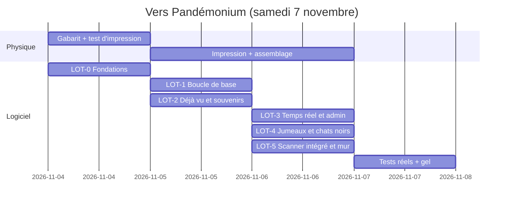

# Plan d'implémentation

[← Index](../README.md)

> **Statut : Proposition.** Périmètre de samedi : **LOT-0 à LOT-5, plus les notifications** ([DEC-017](decisions.md#dec-017), [DEC-076](decisions.md#dec-076)). Valeurs de score : [barème](bareme.md). Architecture tout Cloudflare ([DEC-048](decisions.md#dec-048)). Toutes les questions sont tranchées (S5 à S7).

## 1. Principes
- Chaque lot livre **quelque chose de jouable** et peut être mis en production seul.
- **Le physique d'abord.** L'impression et l'assemblage des étiquettes prennent du temps réel et ne dépendent pas du code de jeu, grâce à [RG-001-9](fonctionnalites/etiquettes-impression.md) : les rôles sont configurés après l'impression. Les séries étant invisibles ([DEC-043](decisions.md#dec-043)), rien n'oblige à décider des rôles avant d'imprimer.
- **Gel du code samedi midi** (Proposition) : ensuite, on ne fait plus que régler des paramètres depuis l'admin.

## 2. Calendrier indicatif (Proposition)

## 3. Lots

### LOT-0 : Fondations et étiquettes
- **Couvre :** [FEAT-001](fonctionnalites/etiquettes-impression.md) ; [FEAT-020](fonctionnalites/admin.md) ADM-1 à ADM-3 ; [FEAT-022](fonctionnalites/costume-mj.md) (étiquettes du MJ, grand format) ; [CT-006](contraintes-techniques.md#ct-006), [CT-007](contraintes-techniques.md#ct-007) ; [REQ-011](exigences-transversales.md#req-011), [REQ-017](exigences-transversales.md#req-017).
- **Dépend de :** rien. Deux formats de gabarit : 40×30 et 40×50 mm.
- **Terminé quand :** les N codes sont générés, chaque URL répond par une page provisoire, et une planche test est imprimée et scannée.
- **Validations :** CA-001-1 à CA-001-4.
- **Incertitudes bloquantes :** aucune.

### LOT-1 : Boucle de base « scanner → créer → collectionner »
- **Couvre :** [FEAT-002](fonctionnalites/scan.md) (QR externe, code manuel, spectateur), [FEAT-003](fonctionnalites/personnage.md) (4 écrans, PIN, faction tirée au hasard, multi-étiquettes), tutoriel et écran d'accueil ([interface §2bis](interface.md#2bis-accueil-et-tutoriel)), [FEAT-004](fonctionnalites/collection.md), [FEAT-019](fonctionnalites/recuperation.md) ; bilinguisme ; REQ-001, 002, 004, 005, 009, 016, 019, 020.
- **Dépend de :** LOT-0. Inclut le tirage parmi les 5 factions et les malus de surconsommation.
- **Terminé quand :** deux personnes réelles créent leur personnage sans clavier et se collectionnent mutuellement.
- **Validations :** CA-002-2 et CA-002-3, CA-003-1 à CA-003-4, CA-004-1 et CA-004-2.

### LOT-2 : Déjà vu, faux souvenirs, réactions, hors ligne
- **Couvre :** [FEAT-005](fonctionnalites/rescan-deja-vu.md), [FEAT-006](fonctionnalites/faux-souvenirs.md), [FEAT-014](fonctionnalites/reactions.md), [FEAT-021](fonctionnalites/pwa-hors-ligne.md), temps d'écran ([RG-015-4](fonctionnalites/badges-classements.md)) ; REQ-003, 006.
- **Dépend de :** LOT-1 ; textes des easter eggs et des faux souvenirs à relire.
- **Terminé quand :** un rescan affiche « Déjà vu ×N » avec les paliers, chaque paire a son souvenir stable, et l'app fonctionne en mode avion après une première visite.
- **Validations :** CA-005-*, CA-006-*, CA-014-*, CA-021-*, CA-004-3, CA-002-4.

### LOT-3 : Temps réel, quête collective, classements, notifications, admin en direct
- **Couvre :** [FEAT-016](fonctionnalites/notifications.md) (Web Push : annonces, jumeau, indices, chat noir, comptes à rebours), [FEAT-009](fonctionnalites/quete-collective.md) (révélation à 5 h avec temps d'écran), [FEAT-015](fonctionnalites/badges-classements.md), [FEAT-020](fonctionnalites/admin.md) ADM-4 à ADM-6 et ADM-9, effets des légendaires et des pièges ([FEAT-022](fonctionnalites/costume-mj.md)) ; REQ-007, 013, 015, 018.
- **Dépend de :** LOT-1 ; dessin caché de la constellation à définir. Inclut le mélange toutes les 20 min, les comptes à rebours, la frise d'activité (ADM-14), le score des factions, les préréglages et suggestions au MJ (ADM-15, ADM-16), le mode pause (ADM-17), les sanctions (ADM-18) et les missions personnelles (ADM-19). Graphe de la révélation en D3.js (proposition, RG-009-13).
- **Terminé quand :** deux téléphones voient la progression bouger en direct, un palier se déclenche chez tous, et la révélation s'affiche à l'heure prévue.
- **Validations :** CA-009-*, CA-015-*, CA-020-*.

### LOT-4 : Jumeaux, triplés, chats noirs
- **Couvre :** [FEAT-007](fonctionnalites/jumeaux.md), [FEAT-008](fonctionnalites/chat-noir.md), ADM-7 ; REQ-003.
- **Dépend de :** LOT-1, LOT-3 (temps réel).
- **Terminé quand :** les groupes de jumeaux se forment dynamiquement et sont complets à 2 h, des retrouvailles mutuelles en moins de 90 s déclenchent l'animation chez les deux, et la contagion (avec immunité et dégressivité) se règle en direct.
- **Validations :** CA-007-*, CA-008-*.

### LOT-5 : Scanner intégré, lampe et mur « Déjà vu ! » (périmètre de samedi)
- **Couvre :** [FEAT-002](fonctionnalites/scan.md) (scanner intégré), [FEAT-017](fonctionnalites/mur-deja-vu.md) ; REQ-008, 010.
- **Dépend de :** LOT-1.
- **Validations :** CA-002-1, CA-017-*.

### LOT-6 : Comparaison, duel, missions, séries
- **Couvre :** [FEAT-010](fonctionnalites/duel.md), [FEAT-013](fonctionnalites/missions-eclair.md), [FEAT-012](fonctionnalites/series-rarete.md).
- **Dépend de :** LOT-3 ; liste des classes D&D et enjeu des duels à définir.
- **Remarque :** la comparaison (RG-010-1 et RG-010-2) est peu coûteuse et a beaucoup de valeur. Elle peut passer dans LOT-2.

### LOT-7 : Factions
- **Couvre :** [FEAT-011](fonctionnalites/factions.md).
- Le tirage de faction est dans LOT-1 et le score dans LOT-3. Ce lot ajoute le rattachement final, les classements et les badges par faction.

### LOT-8 : Lendemain et partage
- **Couvre :** [FEAT-018](fonctionnalites/lendemain-partage.md) ; REQ-014.
- **Peut être livré dimanche**, après la fête.

## 4. Matrice de traçabilité

| Fonctionnalité | Lot | Critères | Questions bloquantes |
|----------------|-----|----------|----------------------|
| FEAT-001 | LOT-0 | CA-001-1…4 | — |
| FEAT-002 | LOT-1 (externe), LOT-5 (intégré) | CA-002-1…4 | — |
| FEAT-003 | LOT-1 | CA-003-1…6 | — |
| FEAT-004 | LOT-1 | CA-004-1…3 | — |
| FEAT-005 | LOT-2 | CA-005-1…4 | — |
| FEAT-006 | LOT-2 | CA-006-1…3 | — |
| FEAT-007 | LOT-4 | CA-007-1…7 | — |
| FEAT-008 | LOT-4 | CA-008-1…5 | — |
| FEAT-009 | LOT-3 | CA-009-1…3 | — |
| FEAT-010 | LOT-6 | CA-010-1…4 | — |
| FEAT-011 | LOT-1 (choix), LOT-7 (score) | CA-011-1…2 | — |
| FEAT-012 | LOT-6 | CA-012-1…2 | — |
| FEAT-013 | LOT-6 | CA-013-1…2 | — |
| FEAT-014 | LOT-2 | CA-014-1…2 | — |
| FEAT-015 | LOT-3 | CA-015-1…3 | — |
| FEAT-016 | LOT-3 | CA-016-1…3 | — |
| FEAT-017 | LOT-5 | CA-017-1…2 | — |
| FEAT-018 | LOT-8 | CA-018-1…2 | — |
| FEAT-019 | LOT-1 | CA-019-1…4 | — |
| FEAT-020 | LOT-0, 3, 4 | CA-020-1…2 | — |
| FEAT-021 | LOT-2 | CA-021-1…3 | — |
| FEAT-022 | LOT-0 (étiquettes), LOT-3 (effets) | CA-022-1…3 | — |

## 5. Vérification avant la fête (Proposition)
1. Test de scan informel dans le noir avec les téléphones disponibles ([DEC-051](decisions.md#dec-051)).
2. Simulation de charge avec 400 joueurs, multipliés par 3.
3. Répétition générale avec 3 à 5 amis : création, collection, retrouvailles de jumeaux, chat noir, révélation avancée de quelques minutes.
4. Vérification de [REQ-017](exigences-transversales.md#req-017) : aucun secret ni spoiler dans le dépôt public.
