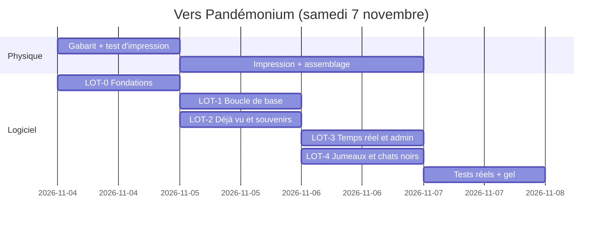

# Plan d'implémentation

[← Index](../README.md)

> **Statut : Proposition.** Ce plan dépend des réponses au [lot 1 des questions](questions-ouvertes.md#lot-1--bloquant-pour-le-socle-jouable), en particulier [Q-028](questions-ouvertes.md#q-028) (périmètre de samedi). Les technologies ne sont pas choisies ([Q-032](questions-ouvertes.md#q-032)).

## 1. Principes
- Chaque lot livre **quelque chose de jouable** et peut être mis en production seul.
- **Le physique d'abord.** L'impression et l'assemblage des étiquettes prennent du temps réel et ne dépendent pas du code de jeu, grâce à [RG-001-9](fonctionnalites/etiquettes-impression.md) : les rôles sont configurés après l'impression. Seules les **séries visibles** ([Q-019](questions-ouvertes.md#q-019)) obligent à décider avant d'imprimer.
- **Gel du code samedi midi** (Proposition) : ensuite, on ne fait plus que régler des paramètres depuis l'admin.

## 2. Calendrier indicatif (Proposition)

## 3. Lots

### LOT-0 : Fondations et étiquettes
- **Couvre :** [FEAT-001](fonctionnalites/etiquettes-impression.md) ; [FEAT-020](fonctionnalites/admin.md) ADM-1 à ADM-3 ; [CT-006](contraintes-techniques.md#ct-006), [CT-007](contraintes-techniques.md#ct-007) ; [REQ-011](exigences-transversales.md#req-011), [REQ-017](exigences-transversales.md#req-017).
- **Dépend de :** [Q-002](questions-ouvertes.md#q-002), [Q-007](questions-ouvertes.md#q-007), [Q-026](questions-ouvertes.md#q-026), [Q-031](questions-ouvertes.md#q-031), [Q-032](questions-ouvertes.md#q-032).
- **Terminé quand :** les N codes sont générés, chaque URL répond par une page provisoire, et une planche test est imprimée et scannée.
- **Validations :** CA-001-1 à CA-001-4.
- **Incertitudes bloquantes :** impression en lot (Q-007), séries visibles (Q-019).

### LOT-1 : Boucle de base « scanner → créer → collectionner »
- **Couvre :** [FEAT-002](fonctionnalites/scan.md) (QR externe et code manuel), [FEAT-003](fonctionnalites/personnage.md), [FEAT-004](fonctionnalites/collection.md) ; REQ-001, 002, 004, 005, 009, 016.
- **Dépend de :** LOT-0 ; [Q-004](questions-ouvertes.md#q-004), [Q-005](questions-ouvertes.md#q-005), [Q-010](questions-ouvertes.md#q-010), [Q-013](questions-ouvertes.md#q-013).
- **Terminé quand :** deux personnes réelles créent leur personnage sans clavier et se collectionnent mutuellement.
- **Validations :** CA-002-2 et CA-002-3, CA-003-1 à CA-003-4, CA-004-1 et CA-004-2.

### LOT-2 : Déjà vu, faux souvenirs, réactions, hors ligne
- **Couvre :** [FEAT-005](fonctionnalites/rescan-deja-vu.md), [FEAT-006](fonctionnalites/faux-souvenirs.md), [FEAT-014](fonctionnalites/reactions.md), [FEAT-021](fonctionnalites/pwa-hors-ligne.md), et [FEAT-019](fonctionnalites/recuperation.md) si elle est retenue ; REQ-003, 006.
- **Dépend de :** LOT-1 ; [Q-012](questions-ouvertes.md#q-012), [Q-016](questions-ouvertes.md#q-016), [Q-017](questions-ouvertes.md#q-017), [Q-025](questions-ouvertes.md#q-025).
- **Terminé quand :** un rescan affiche « Déjà vu ×N » avec les paliers, chaque paire a son souvenir stable, et l'app fonctionne en mode avion après une première visite.
- **Validations :** CA-005-*, CA-006-*, CA-014-*, CA-021-*, CA-004-3, CA-002-4.

### LOT-3 : Temps réel, quête collective, classements, admin en direct
- **Couvre :** [FEAT-009](fonctionnalites/quete-collective.md), [FEAT-015](fonctionnalites/badges-classements.md), [FEAT-020](fonctionnalites/admin.md) ADM-4 à ADM-6 et ADM-9 ; REQ-007, 013, 015, 018.
- **Dépend de :** LOT-1 ; [Q-001](questions-ouvertes.md#q-001), [Q-021](questions-ouvertes.md#q-021).
- **Terminé quand :** deux téléphones voient la progression bouger en direct, un palier se déclenche chez tous, et la révélation s'affiche à l'heure prévue.
- **Validations :** CA-009-*, CA-015-*, CA-020-*.

### LOT-4 : Jumeaux, triplés, chats noirs
- **Couvre :** [FEAT-007](fonctionnalites/jumeaux.md), [FEAT-008](fonctionnalites/chat-noir.md), ADM-7 ; REQ-003.
- **Dépend de :** LOT-1, LOT-3 (temps réel) ; [Q-018](questions-ouvertes.md#q-018), [Q-020](questions-ouvertes.md#q-020), [Q-029](questions-ouvertes.md#q-029).
- **Terminé quand :** des retrouvailles mutuelles en moins de 60 s déclenchent l'animation chez les deux, et la contagion se règle en direct.
- **Validations :** CA-007-*, CA-008-*.

### LOT-5 : Scanner intégré, lampe et mur « Déjà vu ! »
- **Couvre :** [FEAT-002](fonctionnalites/scan.md) (scanner intégré), [FEAT-017](fonctionnalites/mur-deja-vu.md) ; REQ-008, 010.
- **Dépend de :** LOT-1 ; [Q-009](questions-ouvertes.md#q-009), [Q-023](questions-ouvertes.md#q-023).
- **Validations :** CA-002-1, CA-017-*.

### LOT-6 : Comparaison, duel, missions, notifications, séries
- **Couvre :** [FEAT-010](fonctionnalites/duel.md), [FEAT-013](fonctionnalites/missions-eclair.md), [FEAT-016](fonctionnalites/notifications.md), [FEAT-012](fonctionnalites/series-rarete.md).
- **Dépend de :** LOT-3 ; [Q-015](questions-ouvertes.md#q-015), [Q-019](questions-ouvertes.md#q-019).
- **Remarque :** la comparaison (RG-010-1 et RG-010-2) est peu coûteuse et a beaucoup de valeur. Elle peut passer dans LOT-2.

### LOT-7 : Factions
- **Couvre :** [FEAT-011](fonctionnalites/factions.md).
- **Bloqué par :** [Q-014](questions-ouvertes.md#q-014). Ce lot ne peut pas démarrer sans ses règles.

### LOT-8 : Lendemain et partage
- **Couvre :** [FEAT-018](fonctionnalites/lendemain-partage.md) ; REQ-014.
- **Peut être livré dimanche**, après la fête.

## 4. Matrice de traçabilité

| Fonctionnalité | Lot | Critères | Questions bloquantes |
|----------------|-----|----------|----------------------|
| FEAT-001 | LOT-0 | CA-001-1…4 | Q-002, Q-007, Q-026 |
| FEAT-002 | LOT-1 (externe), LOT-5 (intégré) | CA-002-1…4 | Q-009 |
| FEAT-003 | LOT-1 | CA-003-1…4 | Q-004, Q-005, Q-010 |
| FEAT-004 | LOT-1 | CA-004-1…3 | Q-013 |
| FEAT-005 | LOT-2 | CA-005-1…4 | Q-012, Q-016 |
| FEAT-006 | LOT-2 | CA-006-1…3 | Q-017 |
| FEAT-007 | LOT-4 | CA-007-1…4 | Q-018 |
| FEAT-008 | LOT-4 | CA-008-1…4 | Q-020 |
| FEAT-009 | LOT-3 | CA-009-1…3 | Q-001, Q-021 |
| FEAT-010 | LOT-6 | CA-010-1…4 | Q-015 |
| FEAT-011 | LOT-7 | à définir | Q-014 |
| FEAT-012 | LOT-6 | CA-012-1…2 | Q-019 |
| FEAT-013 | LOT-6 | CA-013-1…2 | — |
| FEAT-014 | LOT-2 | CA-014-1…2 | Q-022 |
| FEAT-015 | LOT-3 | CA-015-1…2 | Q-012 |
| FEAT-016 | LOT-6 | CA-016-1…3 | — |
| FEAT-017 | LOT-5 | CA-017-1…2 | Q-023, Q-024 |
| FEAT-018 | LOT-8 | CA-018-1…2 | Q-024 |
| FEAT-019 | LOT-2 (si retenue) | CA-019-1…2 | Q-025 |
| FEAT-020 | LOT-0, 3, 4 | CA-020-1…2 | Q-029 |
| FEAT-021 | LOT-2 | CA-021-1…3 | — |

## 5. Vérification avant la fête (Proposition)
1. Test de scan réel dans le noir avec au moins 3 modèles de téléphones (iPhone, Android, ancien modèle).
2. Simulation de charge avec le nombre de joueurs de [Q-002](questions-ouvertes.md#q-002), multiplié par 3.
3. Répétition générale avec 3 à 5 amis : création, collection, retrouvailles de jumeaux, chat noir, révélation avancée de quelques minutes.
4. Vérification de [REQ-017](exigences-transversales.md#req-017) : aucun secret ni spoiler dans le dépôt public.
